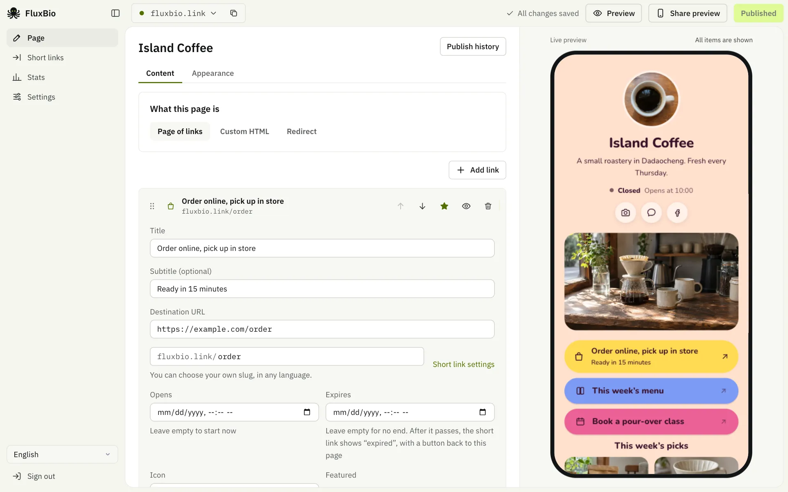
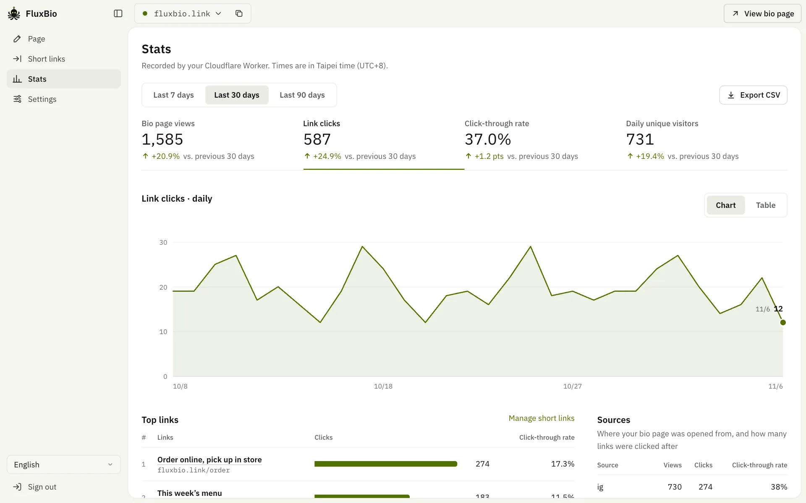
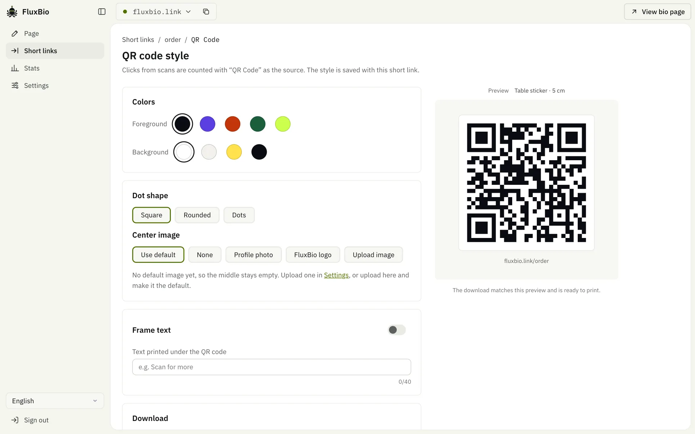

<div align="center">


# FluxBio

**One link that flows to everything you do**

An open-source Link-in-bio and short link tool that runs entirely on your own Cloudflare account.<br>
The free plan is all you need.

<a href="README.md"><kbd>&nbsp;<b>English</b>&nbsp;</kbd></a>
<a href="docs/README.zh-TW.md"><kbd>&nbsp;繁體中文&nbsp;</kbd></a>
<a href="docs/README.zh-CN.md"><kbd>&nbsp;简体中文&nbsp;</kbd></a>
<a href="docs/README.ja.md"><kbd>&nbsp;日本語&nbsp;</kbd></a>
<a href="docs/README.ko.md"><kbd>&nbsp;한국어&nbsp;</kbd></a>
<a href="docs/README.es.md"><kbd>&nbsp;Español&nbsp;</kbd></a>
<a href="docs/README.pt-BR.md"><kbd>&nbsp;Português&nbsp;</kbd></a>
<a href="docs/README.fr.md"><kbd>&nbsp;Français&nbsp;</kbd></a>
<a href="docs/README.de.md"><kbd>&nbsp;Deutsch&nbsp;</kbd></a>
<a href="docs/README.id.md"><kbd>&nbsp;Bahasa Indonesia&nbsp;</kbd></a>
<a href="docs/README.th.md"><kbd>&nbsp;ไทย&nbsp;</kbd></a>
<a href="docs/README.vi.md"><kbd>&nbsp;Tiếng Việt&nbsp;</kbd></a>
<a href="docs/README.ar.md"><kbd>&nbsp;العربية&nbsp;</kbd></a>

[Website](https://fluxbio.link) · [Host your own](#host-your-own) · [Guide for AI agents](AGENTS.md)

[](LICENSE)
[](https://workers.cloudflare.com/)

</div>

<br>

**TL;DR**

- Link-in-bio pages and short links with click stats, in one tool.
- It runs on your own Cloudflare account. The free plan is enough, and your data stays yours.
- [Paste one prompt into your AI](#host-your-own) and it sets everything up. After that, edit in the dashboard or just tell your AI.



Build bio pages in your own style: pick a theme and its colors, or have your AI make one with your own pictures, and add videos, products and opening hours. Every link on your page also has a short link, and you can see what gets clicked, and whether visitors came from IG, Threads or LINE.

## Features

### Run it through your AI

- Create an API token under Settings and paste the prompt on screen into Claude Code, Codex or Cursor. From then on, just ask it to edit pages, make short links, check stats, or change the domain and time zone.
- Every deployment comes with a guide for AIs (`/llms.txt`, `/skill.md`) and an API spec (`/api/openapi.json`). Your AI warns you about the risks before publishing, deleting or changing a URL, and suggests what to do next.

### Bio pages

- One deployment can run several pages, each with its own address, theme and stats.
- 24 themes, each with its own layout and a few color sets: Neon, Vista, Tiles, Candy, Airy, Aurora, Card, Frost, Sunset, Sky, Pop, Portrait, Sheet, Rail, Two-tone, Relief, Bento, Dots, Pastel, Letter, Obsidian, Moon, Chips and Tracks.
- Only need short links? Switch pages off in the dashboard: public pages go offline, short links keep working, and nothing is deleted.
- Don’t want a page of links? Any page can be your own HTML or redirect to another address instead, and either can be your home page.
- Fonts: each theme's fonts load from Google Fonts at no cost to you. One switch on Appearance serves them from your own Worker instead, so visitors never connect to Google (useful if you have visitors in the EU). For any other Google Fonts family, ask your AI; the FAQ says what fonts cost.
- Your own theme: have your AI make one with your colors, fonts, cover picture and background. [Theme files](themes/) other people share can be handed to your AI too.
- Content blocks: links, headings, videos (YouTube/Vimeo), photo carousels, product cards, and opening hours with a map.
- Links can be featured, hidden, or scheduled to appear and disappear.
- Templates for creators, shops, event sign-ups, professionals and organizations get you started in one click.
- The preview image shown when your page is shared on LINE or Facebook is generated automatically to match your theme. That happens when you publish in the dashboard; your AI can use a screenshot of the page instead.
- A LINE button can float at the bottom right, so visitors can add you with one tap.

### Short links

- Every link on a bio page becomes a short link when you publish, and you can create standalone ones too. For a whole batch at once, with UTM tags for each platform, ask your AI. Buttons on a page show the real address; one switch puts the short link on the button instead, for links you’d rather not show, like affiliate links.
- Slugs can use letters in any language, Thai and Hindi included.
- QR codes with your choice of colors, dot shape, center image and frame text, downloadable as PNG, SVG or PDF.
- Start times, expiry dates, password protection and UTM tags.
- Smart routing: open links in an external browser from LINE, show an "open in browser" prompt in the IG and FB in-app browsers, and send iPhone and Android users to different destinations.

### Stats

- Views, clicks, click-through rate and sources: exact counts (D1), by day for 13 months and by month after that.
- Unique visitors, regions, a visitor map, carriers and ISPs, devices, browsers, languages, referring sites, UTM, clicks by hour and recent activity: kept for 90 days (Cloudflare Analytics Engine, no setup needed).
- Comparisons with the previous period, a stats page for every short link, and CSV export.
- No cookies, no IP addresses and no full user-agent strings, and locations go no further than the city. Visitor IDs are a one-way hash that changes every day, and bots aren't counted.

<table>
  <tr>
    <td width="50%"></td>
    <td width="50%"></td>
  </tr>
  <tr>
    <td align="center"><sub>Stats, compared with the period before</sub></td>
    <td align="center"><sub>A QR code for every short link</sub></td>
  </tr>
</table>

### Languages and hosting

- **13 languages:** the dashboard and public pages are available in Traditional Chinese, Simplified Chinese, English, Japanese, Korean, Spanish, Portuguese, French, German, Indonesian, Thai, Vietnamese and Arabic. Public pages use one language you pick, and you can turn on more for visitors whose browser uses them. Your AI can translate your own text into them too.
- **Almost no JavaScript on public pages:** plain HTML served straight from Cloudflare's edge, so pages load fast. One tiny script counts which link was tapped, and the page works without it. Videos and maps load only when a visitor taps them.
- **Self-hosted:** uses only Cloudflare Workers, D1, KV and Analytics Engine, none of which need manual setup, with no other service to sign up for (fonts load from Google Fonts by default, and you can turn that off). Ask your AI to export everything in one package and import it elsewhere to back up your site or move it to another deployment.

## Host your own

Your AI installs the tools it needs. To try it, you only need Claude Code; to put it online, also a free Cloudflare account. Doing it yourself takes Node.js 22.23+, 24.22+ or 26.12+ and pnpm.

### The easy way: hand it to your AI

Paste this into your AI. We recommend [Claude Code](https://code.claude.com/docs/en/quickstart), running on your own computer; Codex, OpenCode, Cursor and others that can run commands with internet access work too:

```text
Follow AGENTS.md in https://github.com/0t2/flux-bio to help me try FluxBio.
Use English (en) as the page language.
```

It first asks whether you’d like to see a sample page on your computer, with no account needed. When you’re happy, it has you sign in to Cloudflare, puts it online and connects itself. You decide when it goes public, and after that just tell it what to change. ChatGPT and Claude in a browser can’t do this, because they can’t run anything on your computer.

> [!NOTE]
> You’ll be asked to allow a few things along the way: your AI asks before it runs commands (downloading the code, installing packages, deploying), Cloudflare has you approve the sign-in in your browser, and your AI asks again before saving its token on your computer. Check what each step does, then allow it.

### Do it yourself

```sh
git clone https://github.com/0t2/flux-bio.git
cd flux-bio
pnpm install
pnpm exec cf auth login          # sign in to Cloudflare (first time only)

# Generate a dashboard password (ADMIN_PASSWORD, at least 12 characters), then deploy
printf 'ADMIN_PASSWORD=%s\n' "$(openssl rand -base64 30 | tr -dc 'A-Za-z0-9' | head -c 24)" > .secrets.env
pnpm exec cf deploy --secrets-file .secrets.env
cat .secrets.env && rm .secrets.env   # save the password somewhere safe
```

Once it's deployed, open `https://<your-site>/admin/` and sign in with the password. First-time setup walks you through creating your first page; then connect your AI in Settings. After that, just ask it about the domain, time zone, backups or a new password. The first deploy creates the D1 database and KV namespace automatically.

## See where visitors come from

FluxBio records where each visit came from, without cookies. Under Stats, **Sources** shows how many people opened your bio page from each platform and how many links they clicked, and **UTM campaigns** breaks this down by the tags on your links.

### Recognized automatically

- **In-app browsers:** Instagram, Threads, Facebook (including Messenger), LINE, X, TikTok, WeChat, Weibo, KakaoTalk, NAVER, Zalo, Snapchat, Pinterest and LinkedIn.
- **Referring sites:** X (t.co), YouTube, Reddit, search engines such as Google, Bing, Yahoo and Baidu, and any other website, shown by its domain.
- **QR codes** made in FluxBio carry `?s=qr`.
- Links on your bio page pass the source on, so a click counts under the platform the visitor came from.

### Tag these yourself

Some places don't say where a visit came from, so it counts as "Direct/other":

- WhatsApp, Telegram, Discord, iMessage and text messages
- emails, newsletters and PDFs
- posters, business cards and other print (use a FluxBio QR code)

Add `?s=` and a name to the link you share there, such as `https://links.example.com/?s=whatsapp`, or `https://links.example.com/talk?s=email` for a short link. Short forms work too: `ig`, `fb`, `x`, `th`, `wa`, `tg`, `mail`, `qr`. A `?s=` tag takes priority over automatic detection.

### Several places on one platform: `utm_content`

Your Instagram bio link, your stories and your posts all count as Instagram. To compare them, give each place its own address:

- in your Instagram bio: `https://links.example.com/?utm_content=bio`
- in a story: `https://links.example.com/?utm_content=story`

Each gets its own row under UTM campaigns, with views and clicks counted separately, and visitors keep the tag when they tap a link on your page. Short links take `utm_source`, `utm_medium`, `utm_campaign` and `utm_content` as well (Short links → Advanced settings). These are added to the destination, so the site you link to sees them too.

> [!TIP]
> Or just ask your AI: "Make tracking links for my Instagram bio, stories and posts."

### Good to know

- You can see where visitors came from, but not who they are. Instagram, Facebook and X never tell other websites which account tapped a link, and FluxBio stores nothing that identifies a person.
- `?s=` names may use letters, digits, `-` and `_`, and are lowercased; other characters are dropped. UTM tags are kept as written, so `story` and `Story` count as two rows. Spell them the same way every time.
- Locations are Cloudflare's estimate of the city, based on the visitor's IP address. VPNs, iCloud Private Relay and company networks can place visitors somewhere else.
- Views, clicks and sources are exact. Each day is kept for 13 months, then each month as one total, for good, and Settings downloads them all. Regions, the map, networks, devices, languages and UTM details are kept for 90 days, and new visits take about a minute to show up. You choose whether social icons count too. Buttons showing the real address are counted by a tiny script on the page, so a blocker can hide a click; short links always count.
- Unique visitors are counted per day. The same person on two different days, or on a phone and then a computer, counts twice.
- Bots and link previews (the request a chat app makes when someone pastes a link) aren't counted, so the numbers can be lower than other tools show.
- A short link's UTM tags go to its main destination only, not to separate iPhone or Android addresses, and never replace a tag the destination already has. Changing them affects only later clicks.
- Apps are recognized by how their in-app browsers identify themselves. If an app changes that, its visits may count as "Direct/other" until FluxBio is updated.

## FAQ

<details>
<summary><b>Does it cost anything?</b></summary>

FluxBio is free and open source. It runs on your own Cloudflare account, whose free plan covers tens of thousands of page views and several hundred changes a day. That’s usually more than individuals and small shops need. Subscriptions to AIs like Claude or ChatGPT are separate, and Claude Code needs a paid Claude plan.

</details>

<details>
<summary><b>Can I try it without a Cloudflare account?</b></summary>

Yes. Your AI makes a sample page on your computer, with no account at all. Its address only opens on your computer, so you can’t send it to a friend, and after a restart you ask your AI to open it again, with nothing lost. When you’re happy, get a free Cloudflare account to put it online, and what you made comes along. If you’d rather not, ask your AI to delete the folder.

</details>

<details>
<summary><b>Can I use it without a Link-in-bio page?</b></summary>

Yes. Any page can be your own HTML or redirect to another address, and either can be your home page: ask your AI, or choose on the page’s Content tab. You can also switch pages off and use only short links.

</details>

<details>
<summary><b>What happens if I use up the free plan? Will I be charged?</b></summary>

You won’t be charged. The free plan needs no card. If a day’s allowance runs out, visitors see an error until it starts over at midnight UTC. If your AI runs on your computer, it can tell you how much is left today.

</details>

<details>
<summary><b>My AI keeps asking if it can run things. What do I press?</b></summary>

That’s normal: it asks before it does anything on your computer. If it’s downloading FluxBio, installing tools or deploying, allow it. If you don’t follow what it wants to do, ask it to explain first.

</details>

<details>
<summary><b>Is my site still there when I turn off my computer? How do I change it tomorrow?</b></summary>

Once it’s online, yes. Your site lives on Cloudflare, not on your computer. To change it, open your AI tool and say what you want, for example “Add my YouTube channel to my FluxBio page”. Claude Code remembers your site; in other tools, paste the prompt from Settings again.

</details>

<details>
<summary><b>Do I need my own domain?</b></summary>

No. You get a free workers.dev address that works once it’s deployed and doesn’t expire. It’s just longer. If you later have a domain on Cloudflare, you can add it, and links you’ve already shared keep working.

</details>

<details>
<summary><b>What if I try it and don’t want it?</b></summary>

You can just leave it: it costs nothing. To remove everything, tell your AI “Delete my whole FluxBio”. It offers to save a backup and checks with you before deleting anything.

</details>

<details>
<summary><b>Can I use other fonts?</b></summary>

Every theme comes with its fonts. For any Google Fonts family, tell your AI, for example "Change my headings to Playfair Display": it finds the font, tells you what it costs and publishes the page. By default fonts load from Google Fonts, which costs you nothing, but visitors' browsers connect to Google; a German court ruled in 2022 that under the GDPR this needs their consent. If you have visitors in the EU, turn on "Load fonts from your own site" on Appearance: publishing then copies just the characters your page uses to your own Worker, and each font file costs one request and one KV read per new visitor (a page has two or three for its built-in font). That is plenty for most pages, but a busy page with extra fonts reaches the daily limit sooner, so add one font at most, for headings. If you run FluxBio's code with an AI that can change it, such as Claude Code, it can cut the cost further (AGENTS.md says how).

</details>

<details>
<summary><b>Where is my data stored?</b></summary>

All of it is in your Cloudflare account: pages, short links and stats in D1, images in KV. There is no central server, and the author can't see your data. Published pages and short links are public. Drafts are visible only to you and anyone with a preview link, and stats and the dashboard need a sign-in.

</details>

<details>
<summary><b>How are the dashboard password, API tokens and Cloudflare credentials different?</b></summary>

The **dashboard password** is how you sign in to the dashboard. It’s made for you when you deploy, and you can change it anytime. **API tokens** are for AIs and tools: give each AI its own, limit one to creating short links if you like, and revoke any of them without affecting the rest. **Cloudflare credentials** are for what only Cloudflare can do, like deploying or connecting a domain. They control your whole Cloudflare account, so never paste them into a chat.

</details>

<details>
<summary><b>What if a token leaks?</b></summary>

Revoke it under Settings and make a new one. If the dashboard password leaks, ask your AI to change it: everyone gets signed out, and every token stops working too.

</details>

<details>
<summary><b>What if the AI gets something wrong?</b></summary>

Page edits go to a draft, and visitors see nothing until it’s published. Settings and standalone short links change at once. FluxBio’s guide tells your AI to explain what will change and ask you first, to ask whether to publish straight away or preview first, and to save a backup before it starts. If something goes wrong, it can put back one of a page’s last 20 published versions, or restore a backup. A tool that doesn’t read the guide won’t do any of this, so only give full access to an AI you trust.

</details>

<details>
<summary><b>Can I use it without an AI?</b></summary>

Yes. Pages, appearance, short links, QR codes, stats and backup downloads are all in the dashboard. Settings like the domain and time zone, and a look with your own colors and pictures, have no screen and are changed through the API; every FluxBio explains how at `/llms.txt`.

</details>

<details>
<summary><b>Which AIs does it work with?</b></summary>

To deploy: we recommend Claude Code on your own computer. Other coding agents that can run commands with internet access work too, such as Codex, OpenCode, Cursor, Cline, Roo Code, Kilo Code, Droid, Crush, Goose, Pi, TRAE, Qoder, ZCode, Eigent, Gemini CLI, GitHub Copilot or Windsurf. To run your site day to day: those, plus anything that can call an API, such as the Claude app, Claude Cowork, ChatGPT (custom GPTs) or n8n. Settings in the dashboard gives you a prompt to paste into Claude Code, Codex or Cursor; for anything else, point it at your site’s /llms.txt.

</details>

<details>
<summary><b>How do I change the domain or password, or move my site?</b></summary>

Just ask your AI: "Switch the domain to links.example.com", "Change my dashboard password", "Move my site to another FluxBio". A new domain first has to be connected to this Worker in Cloudflare, and your AI will walk you through it.

</details>

<details>
<summary><b>Does it track visitors?</b></summary>

FluxBio uses no cookies and stores no IP addresses or full user-agent strings. For each visit it keeps the time, where the visitor came from, their device, browser, language, network and rough location (about 10 km at best) for 90 days, with a one-way hash that changes every day. Totals are kept for good. Known bots and link previews don’t count. Two things do reach Google: fonts load from Google Fonts unless you turn that off under Appearance, and a page with a YouTube video loads its thumbnail from there.

</details>

## Development

```sh
cp .dev.vars.example .dev.vars   # set ADMIN_PASSWORD for local development
pnpm dev                         # http://localhost:5173, dashboard at /admin/
pnpm test                        # runs the tests in the Workers runtime
pnpm typecheck
```

The architecture, project layout and development guidelines are all in [AGENTS.md](AGENTS.md).

Built with Cloudflare Workers, D1, KV, Analytics Engine, Hono, React 19, Vite and the [`cf` CLI](https://www.npmjs.com/package/cf).

## License

- The app: [AGPL-3.0-only](LICENSE). You're free to self-host and modify it; if you offer a modified version as a public service, you must publish your modified source code too.
- `src/templates/` (the public page themes and renderer) and `themes/` (the themes' color sets): [MIT](src/templates/LICENSE), so they're easy to reuse.
