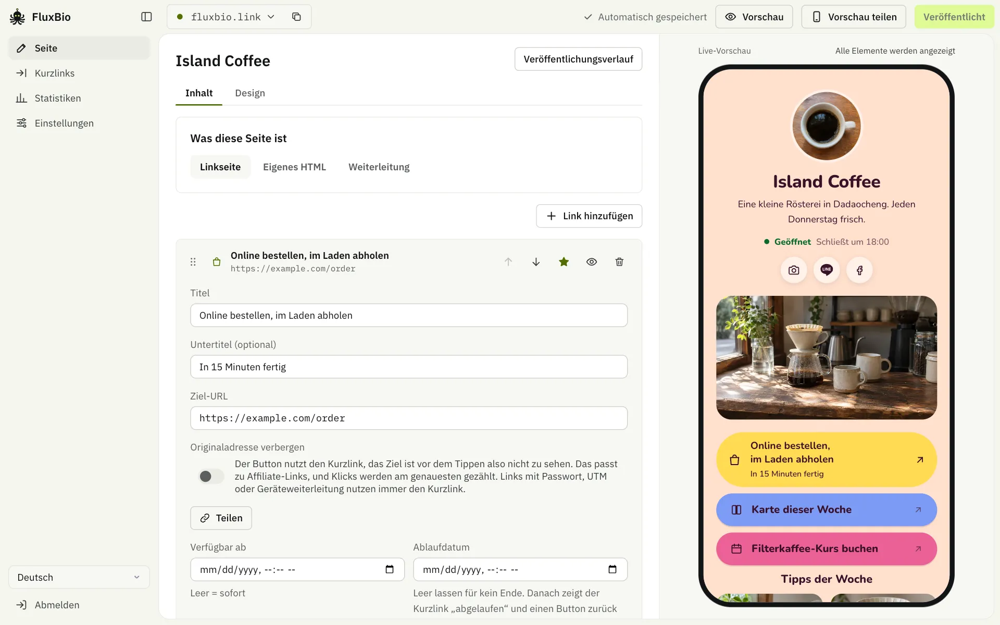
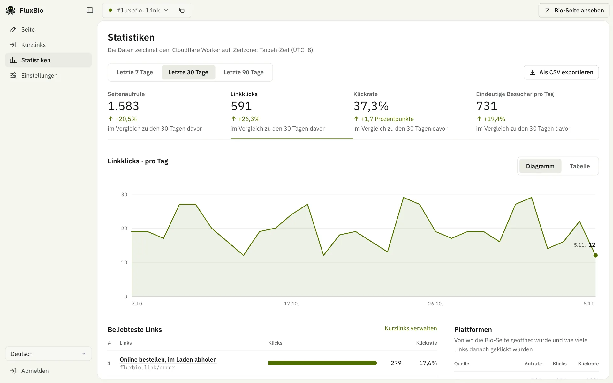
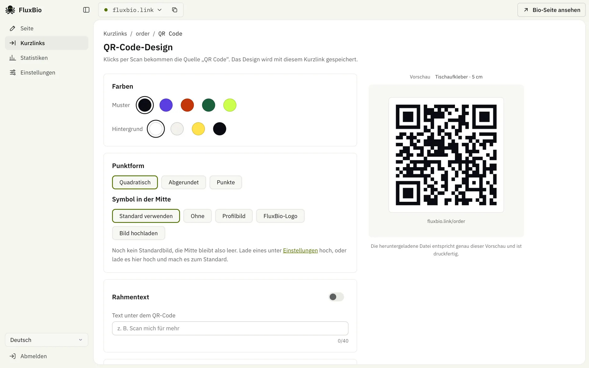

<div align="center">


# FluxBio

**Ein Link für dein ganzes Schaffen**

Open-Source-Link-in-Bio mit Kurzlinks, das komplett auf deinem eigenen Cloudflare-Konto läuft. Der kostenlose Plan reicht dafür.

<a href="../README.md"><kbd>&nbsp;English&nbsp;</kbd></a>
<a href="README.zh-TW.md"><kbd>&nbsp;繁體中文&nbsp;</kbd></a>
<a href="README.zh-CN.md"><kbd>&nbsp;简体中文&nbsp;</kbd></a>
<a href="README.ja.md"><kbd>&nbsp;日本語&nbsp;</kbd></a>
<a href="README.ko.md"><kbd>&nbsp;한국어&nbsp;</kbd></a>
<a href="README.es.md"><kbd>&nbsp;Español&nbsp;</kbd></a>
<a href="README.pt-BR.md"><kbd>&nbsp;Português&nbsp;</kbd></a>
<a href="README.fr.md"><kbd>&nbsp;Français&nbsp;</kbd></a>
<a href="README.de.md"><kbd>&nbsp;<b>Deutsch</b>&nbsp;</kbd></a>
<a href="README.id.md"><kbd>&nbsp;Bahasa Indonesia&nbsp;</kbd></a>
<a href="README.th.md"><kbd>&nbsp;ไทย&nbsp;</kbd></a>
<a href="README.vi.md"><kbd>&nbsp;Tiếng Việt&nbsp;</kbd></a>
<a href="README.ar.md"><kbd>&nbsp;العربية&nbsp;</kbd></a>

[Landingpage](https://fluxbio.link) · [Selbst hosten](#selbst-hosten) · [Anleitung für KI-Agenten](../AGENTS.md)

[](../LICENSE)
[](https://workers.cloudflare.com/)

</div>

<br>

**TL;DR**

- Link-in-Bio-Seiten und Kurzlinks mit Klickstatistik in einem Tool.
- Läuft in deinem eigenen Cloudflare-Konto. Der kostenlose Tarif reicht, und deine Daten bleiben bei dir.
- [Füge einen Prompt in deine KI ein](#selbst-hosten), und sie richtet alles ein. Danach bearbeitest du im Dashboard oder sagst es einfach deiner KI.



Bau dir Bio-Seiten in deinem Stil: Wähle ein Theme und seine Farben oder lass deine KI eines mit deinen Bildern bauen, dazu kommen Videos, Produkte und Öffnungszeiten. Jeder Link auf der Seite hat auch einen Kurzlink, und du siehst, was angeklickt wird und ob die Besucher von IG, Threads oder LINE kommen.

## Funktionen

### Von deiner KI verwaltet

- Erstelle unter Einstellungen ein API-Token und füge den angezeigten Prompt in Claude Code, Codex oder Cursor ein. Ab dann bittest du sie einfach, Seiten zu bearbeiten, Kurzlinks zu erstellen, Statistiken zu prüfen oder Domain und Zeitzone zu ändern.
- Jede Installation bringt eine Anleitung für KIs (`/llms.txt`, `/skill.md`) und die API-Spezifikation (`/api/openapi.json`) mit. Vor Aktionen wie Veröffentlichen, Löschen oder Adressänderungen weist die KI dich auf Risiken hin, und sie macht auch Vorschläge.

### Bio-Seiten

- Eine Installation verwaltet mehrere Seiten, jede mit eigener Adresse, eigenem Theme und eigenen Statistiken.
- 24 Themes, jedes mit eigenem Layout und mehreren Farbsets: Neon, Panorama, Kacheln, Bonbon, Luftig, Polarlicht, Karte, Milchglas, Abendrot, Himmel, Pop, Porträt, Blatt, Leiste, Zweifarbig, Relief, Bento, Punkte, Pastell, Brief, Obsidian, Mond, Chips und Titel.
- Nur Kurzlinks? Schalte die Seiten im Dashboard aus: Öffentliche Seiten gehen offline, Kurzlinks funktionieren weiter und nichts wird gelöscht.
- Keine Linkseite gewünscht? Jede Seite kann dein eigenes HTML sein oder zu einer anderen Adresse weiterleiten, und beides kann deine Startseite sein.
- Schriften: Die Schriften der Themes kommen von Google Fonts und kosten dich kein Kontingent. Ein Schalter unter Design liefert sie stattdessen von deinem eigenen Worker aus, Besucher verbinden sich dann nie mit Google (praktisch bei Besuchern aus der EU). Jede andere Google-Fonts-Schrift übernimmt deine KI; was Schriften verbrauchen, steht in den FAQ.
- Dein eigenes Theme: Lass deine KI eines mit deinen Farben, Schriften, Titel- und Hintergrundbild bauen. [Theme-Dateien](../themes/), die andere teilen, wendet deine KI ebenfalls an.
- Inhaltsblöcke: Links, Überschriften, Videos (YouTube oder Vimeo), Bilderkarussells, Produktkarten, Öffnungszeiten mit Karte.
- Links lassen sich hervorheben, ausblenden oder zeitgesteuert ein- und ausblenden.
- Vorlagen für Creator, Läden, Events, Freiberufler und Vereine: mit einem Klick loslegen.
- Das Vorschaubild beim Teilen auf LINE oder Facebook wird automatisch passend zum Theme erstellt. Das passiert beim Veröffentlichen im Dashboard; deine KI kann stattdessen einen Screenshot der Seite verwenden.
- Unten rechts kann ein LINE-Button schweben, damit Besucher dich mit einem Tipp hinzufügen.

### Kurzlinks

- Jeder Link auf deiner Bio-Seite wird beim Veröffentlichen automatisch zum Kurzlink, du kannst aber auch eigenständige anlegen. Viele auf einmal, mit UTM pro Plattform? Das übernimmt deine KI. Buttons auf der Seite zeigen die echte Adresse; ein Schalter setzt stattdessen den Kurzlink ein, für alles, was du nicht zeigen willst, etwa Affiliate-Links.
- Kürzel dürfen Buchstaben aus jeder Sprache enthalten, Umlaute, Thai und Hindi inklusive.
- QR-Codes mit eigenen Farben, Punktform, Icon in der Mitte und Rahmentext, zum Download als PNG, SVG oder PDF.
- Startzeitpunkt, Ablaufdatum, Passwortschutz, UTM.
- Intelligente Weiterleitung: in LINE im externen Browser öffnen, in den In-App-Browsern von IG und FB zuerst einen Hinweis zum Öffnen im Browser zeigen, iPhone und Android getrennt weiterleiten.

### Statistiken

- Aufrufe, Klicks, Klickrate und Quellen: exakt gezählt und dauerhaft gespeichert (D1).
- Eindeutige Besucher, Regionen, Besucherkarte, Netzbetreiber, Geräte, Browser, Sprachen, verweisende Websites, UTM, Klickzeiten und letzte Aktivität: 90 Tage lang (Cloudflare Analytics Engine, ohne Einrichtung).
- Vergleich mit dem Vorzeitraum, eine eigene Statistikseite für jeden Kurzlink, CSV-Export.
- Keine Cookies, keine IP-Adressen, keine vollständigen User-Agent-Strings, Standorte nur bis zur Stadt. Die Besucher-ID ist ein Einweg-Hash, der sich täglich ändert. Bots werden nicht mitgezählt.

<table>
  <tr>
    <td width="50%"></td>
    <td width="50%"></td>
  </tr>
  <tr>
    <td align="center"><sub>Statistiken im Vergleich zum Zeitraum davor</sub></td>
    <td align="center"><sub>Ein QR-Code für jeden Kurzlink</sub></td>
  </tr>
</table>

### Sprachen und Hosting

- **13 Sprachen**: Dashboard und öffentliche Seiten gibt es auf 繁體中文, 简体中文, English, 日本語, 한국어, Español, Português, Français, Deutsch, Bahasa Indonesia, ไทย, Tiếng Việt und العربية. Öffentliche Seiten nutzen die Sprache, die du wählst; weitere kannst du für Besucher mit dieser Browsersprache einschalten. Deine KI kann auch deine eigenen Texte in diese Sprachen übersetzen.
- **Kaum JavaScript auf öffentlichen Seiten**: reines HTML, direkt vom Cloudflare-Edge ausgeliefert und entsprechend schnell. Nur ein winziges Skript zählt die Klicks, und die Seite funktioniert auch ohne es. Videos und Karten laden erst, wenn Besucher darauf tippen.
- **Selbst gehostet**: nur Workers, D1, KV und Analytics Engine von Cloudflare, alles ohne manuelle Einrichtung und ohne weiteren Dienst, bei dem du dich anmelden müsstest (Schriften kommen standardmäßig von Google Fonts, das lässt sich abschalten). Lass deine KI alle Inhalte exportieren und wieder importieren, um ein Backup zu machen oder auf eine andere Installation umzuziehen.

## Selbst hosten

Deine KI installiert die nötigen Werkzeuge selbst. Zum Ausprobieren brauchst du nur Claude Code, zum Veröffentlichen auch ein kostenloses Cloudflare-Konto. Wenn du es selbst machst, brauchst du Node.js 22.23+, 24.22+ oder 26.12+ und pnpm.

### Am einfachsten: Überlass es deiner KI

Füge das in deine KI ein. Wir empfehlen [Claude Code](https://code.claude.com/docs/en/quickstart) auf deinem eigenen Rechner, aber auch Codex, OpenCode, Cursor und andere, die Befehle ausführen können und Internetzugang haben, funktionieren:

```text
Hilf mir, FluxBio auszuprobieren, wie in der AGENTS.md unter https://github.com/0t2/flux-bio beschrieben.
Nimm Deutsch (de) als Seitensprache.
```

Zuerst fragt sie, ob du eine Beispielseite auf deinem Rechner sehen möchtest, ganz ohne Konto. Wenn sie dir gefällt, lässt sie dich bei Cloudflare anmelden, stellt sie online und verbindet sich. Du entscheidest, wann sie öffentlich wird, und danach sagst du einfach, was sich ändern soll. ChatGPT und Claude im Browser können das nicht, weil sie auf deinem Rechner nichts ausführen können.

> [!NOTE]
> Unterwegs wirst du ein paar Mal um Erlaubnis gefragt: Deine KI fragt, bevor sie Befehle ausführt (Code herunterladen, Pakete installieren, deployen), Cloudflare lässt dich die Anmeldung im Browser bestätigen, und bevor die KI ihr Token auf deinem Rechner speichert, fragt sie noch einmal. Sieh dir an, was jeder Schritt tut, und erlaube ihn dann.

### Selbst machen

```sh
git clone https://github.com/0t2/flux-bio.git
cd flux-bio
pnpm install
pnpm exec cf auth login          # beim ersten Mal bei Cloudflare anmelden

# Dashboard-Passwort erzeugen (ADMIN_PASSWORD, mindestens 12 Zeichen), dann deployen
printf 'ADMIN_PASSWORD=%s\n' "$(openssl rand -base64 30 | tr -dc 'A-Za-z0-9' | head -c 24)" > .secrets.env
pnpm exec cf deploy --secrets-file .secrets.env
cat .secrets.env && rm .secrets.env   # Passwort gut aufbewahren
```

Öffne nach dem Deployment `https://<deine-adresse>/admin/` und melde dich mit dem Passwort an. Die Ersteinrichtung führt dich durch deine erste Seite; deine KI verbindest du danach unter „Einstellungen“. Domain, Zeitzone, Backups und Passwortwechsel sagst du ihr danach einfach. Beim ersten Deployment werden die D1-Datenbank und der KV-Namespace automatisch angelegt.

## Woher deine Besucher kommen

FluxBio hält ohne Cookies fest, woher jeder Besuch kommt. Unter „Statistiken“ zeigt „Plattformen“, wie viele Leute deine Bio-Seite von welcher Plattform aus geöffnet und wie viele Links sie danach geklickt haben; „UTM-Kampagnen“ schlüsselt das nach den Tags deiner Links auf.

### Wird automatisch erkannt

- **In-App-Browser:** Instagram, Threads, Facebook (mit Messenger), LINE, X, TikTok, WeChat, Weibo, KakaoTalk, NAVER, Zalo, Snapchat, Pinterest und LinkedIn.
- **Verweisende Websites:** X (t.co), YouTube, Reddit, Suchmaschinen wie Google, Bing, Yahoo und Baidu sowie jede andere Website, angezeigt mit ihrer Domain.
- **QR-Codes** aus FluxBio tragen `?s=qr`.
- Die Links auf deiner Bio-Seite geben die Quelle weiter, ein Klick zählt also für die Plattform, von der der Besuch kam.

### Musst du selbst markieren

Manche Orte verraten nicht, woher ein Besuch kommt; er zählt dann als „Direkt / Sonstige“:

- WhatsApp, Telegram, Discord, iMessage und SMS
- E-Mails, Newsletter und PDFs
- Plakate, Visitenkarten und andere Drucksachen (nimm einen QR-Code aus FluxBio)

Hänge an den Link, den du dort teilst, `?s=` und einen Namen an, etwa `https://links.example.com/?s=whatsapp` oder bei einem Kurzlink `https://links.example.com/talk?s=email`. Kurzformen gehen auch: `ig`, `fb`, `x`, `th`, `wa`, `tg`, `mail`, `qr`. Ein `?s=`-Tag hat Vorrang vor der automatischen Erkennung.

### Mehrere Stellen auf einer Plattform: `utm_content`

Der Link in deiner Instagram-Bio, deine Storys und deine Beiträge zählen alle als Instagram. Um sie zu vergleichen, gib jeder Stelle eine eigene Adresse:

- in der Instagram-Bio: `https://links.example.com/?utm_content=bio`
- in einer Story: `https://links.example.com/?utm_content=story`

Jede bekommt unter „UTM-Kampagnen“ eine eigene Zeile, mit Aufrufen und Klicks getrennt gezählt, und Besucher behalten das Tag, wenn sie auf deiner Seite einen Link antippen. Kurzlinks nehmen ebenfalls `utm_source`, `utm_medium`, `utm_campaign` und `utm_content` an („Kurzlinks“ → „Erweiterte Einstellungen“). Sie werden an das Ziel angehängt, die verlinkte Website sieht sie also auch.

> [!TIP]
> Oder sag einfach deiner KI: „Mach Tracking-Links für meine Instagram-Bio, meine Storys und meine Beiträge.“

### Gut zu wissen

- Du siehst, woher Besucher kommen, aber nicht, wer sie sind. Instagram, Facebook und X verraten anderen Websites nie, welches Konto einen Link angetippt hat, und FluxBio speichert nichts, was eine Person erkennbar macht.
- Namen in `?s=` dürfen Buchstaben ohne Umlaute, Ziffern, `-` und `_` enthalten und werden kleingeschrieben; andere Zeichen fallen weg. UTM-Tags bleiben, wie sie geschrieben sind, `story` und `Story` zählen also als zwei Zeilen. Schreib sie immer gleich.
- Der Ort ist die Stadt, die Cloudflare anhand der IP-Adresse schätzt. VPNs, iCloud Privat-Relay und Firmennetze können Besucher woanders verorten.
- Aufrufe, Klicks und Quellen sind exakt und bleiben dauerhaft gespeichert. Regionen, Karte, Netzwerke, Geräte, Sprachen und UTM-Details bleiben 90 Tage, und neue Besuche erscheinen nach etwa einer Minute. Ob auch Social-Icons zählen, entscheidest du selbst. Buttons mit der echten Adresse zählt ein winziges Skript auf der Seite, ein Blocker kann also einen Klick verbergen; Kurzlinks zählen immer.
- Eindeutige Besucher werden pro Tag gezählt: Dieselbe Person an zwei Tagen oder erst am Handy, dann am Computer zählt doppelt.
- Bots und Linkvorschauen (der Abruf, den eine Chat-App macht, wenn jemand einen Link einfügt) zählen nicht, die Zahlen können also niedriger sein als in anderen Tools.
- Die UTM-Tags eines Kurzlinks gehen nur an sein Hauptziel, nicht an eigene iPhone- oder Android-Adressen, und ersetzen nie ein Tag, das das Ziel schon hat. Änderungen gelten erst für spätere Klicks.
- Apps werden daran erkannt, wie sich ihr In-App-Browser ausweist. Ändert eine App das, können ihre Besuche als „Direkt / Sonstige“ zählen, bis FluxBio angepasst ist.

## Häufige Fragen

<details>
<summary><b>Kostet das etwas?</b></summary>

FluxBio ist kostenlos und Open Source. Es läuft in deinem eigenen Cloudflare-Konto, dessen kostenloser Tarif Zehntausende Seitenaufrufe und mehrere Hundert Änderungen pro Tag abdeckt. Das ist für Einzelpersonen und kleine Läden meist mehr als genug. Abos für KIs wie Claude oder ChatGPT kommen extra, und Claude Code braucht einen kostenpflichtigen Claude-Tarif.

</details>

<details>
<summary><b>Kann ich es ohne Cloudflare-Konto ausprobieren?</b></summary>

Ja. Deine KI baut eine Beispielseite auf deinem Rechner, ganz ohne Konto. Die Adresse öffnet sich nur auf deinem Rechner, du kannst sie also niemandem schicken. Nach einem Neustart bittest du deine KI, sie wieder zu öffnen, und nichts ist verloren. Wenn sie dir gefällt, legst du ein kostenloses Cloudflare-Konto an und stellst sie online, und was du gebaut hast, kommt mit. Wenn nicht, bittest du deine KI, den Ordner zu löschen.

</details>

<details>
<summary><b>Kann ich es ohne Linkseite nutzen?</b></summary>

Ja. Jede Seite kann dein eigenes HTML sein oder zu einer anderen Adresse weiterleiten, und beides kann deine Startseite sein: Bitte deine KI darum oder wähle es im Tab „Inhalt“ der Seite. Du kannst Seiten auch ausschalten und nur Kurzlinks nutzen.

</details>

<details>
<summary><b>Was passiert, wenn der kostenlose Tarif aufgebraucht ist? Kostet das etwas?</b></summary>

Es kostet nichts. Der kostenlose Tarif braucht keine Karte. Ist das Tageskontingent aufgebraucht, sehen Besucher einen Fehler, bis es um Mitternacht UTC neu beginnt. Läuft deine KI auf deinem Computer, kann sie dir sagen, wie viel heute noch übrig ist.

</details>

<details>
<summary><b>Meine KI fragt ständig, ob sie etwas ausführen darf. Was soll ich drücken?</b></summary>

Das ist normal: Sie fragt, bevor sie auf deinem Computer etwas tut. Geht es ums Herunterladen von FluxBio, ums Installieren von Werkzeugen oder ums Bereitstellen, erlaube es. Wenn du nicht verstehst, was sie vorhat, lass es dir zuerst erklären.

</details>

<details>
<summary><b>Ist meine Seite noch da, wenn ich den Computer ausschalte? Wie ändere ich sie morgen?</b></summary>

Sobald sie online ist, ja. Deine Seite liegt bei Cloudflare, nicht auf deinem Computer. Um sie zu ändern, öffne dein KI-Werkzeug und sag, was du möchtest, zum Beispiel „Füge meinen YouTube-Kanal zu meiner FluxBio-Seite hinzu“. Claude Code merkt sich deine Seite; in anderen Tools füge den Prompt aus den Einstellungen erneut ein.

</details>

<details>
<summary><b>Brauche ich eine eigene Domain?</b></summary>

Nein. Du bekommst eine kostenlose workers.dev-Adresse, die sofort nach dem Deployment funktioniert und nicht abläuft. Sie ist nur länger. Wenn du später eine Domain bei Cloudflare hast, kannst du sie ergänzen, und bereits geteilte Links funktionieren weiter.

</details>

<details>
<summary><b>Was, wenn ich es ausprobiere und nicht behalten will?</b></summary>

Du kannst es einfach liegen lassen, es kostet nichts. Um alles zu entfernen, sag deiner KI „Lösche mein ganzes FluxBio“. Sie bietet ein Backup an und fragt nach, bevor sie etwas löscht.

</details>

<details>
<summary><b>Kann ich andere Schriften verwenden?</b></summary>

Jedes Theme bringt seine Schriften mit. Für jede Schrift von Google Fonts sag deiner KI Bescheid, etwa „Stell die Überschriften auf Playfair Display um“: Sie sucht die Schrift, sagt dir, was sie verbraucht, und veröffentlicht die Seite. Standardmäßig kommen Schriften von Google Fonts und kosten dich kein Kontingent, aber die Browser der Besucher verbinden sich mit Google; ein deutsches Gericht hat 2022 entschieden, dass das nach der DSGVO ihre Einwilligung braucht. Wenn du Besucher aus der EU hast, schalte unter Design „Schriften von deiner Website laden“ ein: Beim Veröffentlichen werden nur die Zeichen der Seite auf deinen eigenen Worker kopiert, und jede Schriftdatei kostet pro neuem Besucher eine Anfrage und einen KV-Lesevorgang (eine Seite hat für ihre eingebaute Schrift schon zwei oder drei). Für die meisten Seiten reicht das locker; eine viel besuchte Seite mit zusätzlichen Schriften erreicht das Tageslimit früher, nimm also am besten höchstens eine dazu, für Überschriften. Wenn du den Code von FluxBio mit einer KI verwaltest, die ihn ändern kann, etwa Claude Code, kann sie den Verbrauch weiter senken (wie, steht in AGENTS.md).

</details>

<details>
<summary><b>Wo liegen meine Daten?</b></summary>

Alles liegt in deinem Cloudflare-Konto: Seiten, Kurzlinks und Statistiken in D1, Bilder in KV. Es gibt keinen zentralen Server, und der Entwickler sieht deine Daten nicht. Veröffentlichte Seiten und Kurzlinks sind öffentlich. Entwürfe sehen nur du und alle mit einem Vorschaulink; Statistiken und das Dashboard brauchen eine Anmeldung.

</details>

<details>
<summary><b>Dashboard-Passwort, API-Token, Cloudflare-Schlüssel: Was ist der Unterschied?</b></summary>

Mit dem **Dashboard-Passwort** meldest du dich im Dashboard an. Es wird beim Deployment für dich erzeugt und lässt sich jederzeit ändern. **API-Tokens** sind für KIs und Tools: eins pro KI, auf Wunsch eins nur mit der Berechtigung „Kurzlink erstellen“, und jedes lässt sich einzeln widerrufen, ohne die anderen zu stören. **Cloudflare-Zugangsdaten** sind für alles, was nur Cloudflare kann, etwa Deployen oder eine Domain verbinden. Sie steuern dein ganzes Cloudflare-Konto, also füg sie nie in einen Chat ein.

</details>

<details>
<summary><b>Was tun, wenn ein Token geleakt ist?</b></summary>

Widerrufe es unter „Einstellungen“ und erstelle ein neues. Ist das Dashboard-Passwort geleakt, lass es von deiner KI ändern. Danach müssen sich alle neu anmelden, und alle Tokens werden ungültig.

</details>

<details>
<summary><b>Was, wenn die KI etwas falsch macht?</b></summary>

Änderungen an Seiten landen in einem Entwurf, und Besucher sehen nichts, bis er veröffentlicht ist. Einstellungen und eigenständige Kurzlinks ändern sich sofort. Der Leitfaden von FluxBio sagt deiner KI, dass sie erklären soll, was sich ändert, und vorher nachfragt, dass sie fragt, ob direkt veröffentlicht oder zuerst eine Vorschau gezeigt werden soll, und dass sie vor dem Start ein Backup speichert. Geht etwas schief, kann sie eine der letzten 20 veröffentlichten Versionen einer Seite zurückholen oder ein Backup wiederherstellen. Ein Tool, das den Leitfaden nicht liest, tut nichts davon – gib also nur einer KI, der du vertraust, vollen Zugriff.

</details>

<details>
<summary><b>Geht es auch ohne KI?</b></summary>

Ja. Seiten, Design, Kurzlinks, QR-Codes, Statistiken und den Backup-Download findest du alle im Dashboard. Für Domain, Zeitzone und ein Design mit eigenen Farben und Bildern gibt es keine Oberfläche, die änderst du über die API. Wie das geht, steht in der `/llms.txt` jeder FluxBio-Installation.

</details>

<details>
<summary><b>Welche KIs werden unterstützt?</b></summary>

Zum Deployen: Wir empfehlen Claude Code auf deinem eigenen Rechner, aber auch andere Coding-Tools, die Befehle ausführen können und Internetzugang haben, funktionieren, etwa Codex, OpenCode, Cursor, Cline, Roo Code, Kilo Code, Droid, Crush, Goose, Pi, TRAE, Qoder, ZCode, Eigent, Gemini CLI, GitHub Copilot oder Windsurf. Für den Alltag: diese und jedes Tool, das eine API aufrufen kann, etwa die Claude-App, Claude Cowork, ChatGPT (eigenes GPT) oder n8n. Unter „Einstellungen“ im Dashboard findest du einen Prompt zum Einfügen in Claude Code, Codex oder Cursor; bei allem anderen verweise auf die /llms.txt deiner Seite.

</details>

<details>
<summary><b>Wie wechsle ich Domain oder Passwort, wie ziehe ich um?</b></summary>

Sag es einfach deiner KI: „Stell die Domain auf links.example.com um“, „Ändere das Dashboard-Passwort“, „Zieh die Website auf ein anderes FluxBio um“. Die Domain muss zuerst in Cloudflare mit diesem Worker verbunden sein, deine KI führt dich Schritt für Schritt durch.

</details>

<details>
<summary><b>Werden Besucher getrackt?</b></summary>

FluxBio verwendet keine Cookies und speichert weder IP-Adressen noch vollständige User-Agent-Strings. Zu jedem Besuch werden 90 Tage lang Uhrzeit, Herkunft, Gerät, Browser, Sprache, Netzwerk und ungefährer Standort (bestenfalls etwa 10 km genau) gespeichert, dazu ein Einweg-Hash, der sich täglich ändert. Die Summen bleiben dauerhaft erhalten. Bekannte Bots und Linkvorschauen zählen nicht mit. Zwei Dinge erreichen Google: Schriften werden von Google Fonts geladen, solange du das unter Design nicht ausschaltest, und eine Seite mit einem YouTube-Video lädt dessen Vorschaubild von dort.

</details>

## Entwicklung

```sh
cp .dev.vars.example .dev.vars   # ADMIN_PASSWORD für die lokale Entwicklung setzen
pnpm dev                         # http://localhost:5173 (Dashboard unter /admin/)
pnpm test                        # Tests in der Workers-Runtime ausführen
pnpm typecheck
```

Architektur, Verzeichnisstruktur und Entwicklungsregeln stehen in der [AGENTS.md](../AGENTS.md).

Technik: Cloudflare Workers, D1, KV, Analytics Engine, Hono, React 19, Vite und die [`cf` CLI](https://www.npmjs.com/package/cf).

## Lizenz

- Hauptprogramm: [AGPL-3.0-only](../LICENSE). Selbst hosten und anpassen ist frei erlaubt; wer es als öffentlichen Dienst anbietet, muss auch den geänderten Quellcode veröffentlichen.
- `src/templates/` (Themes und Renderer der öffentlichen Seiten) und `themes/` (Farbsets der Themes): [MIT](../src/templates/LICENSE), damit sie sich leicht wiederverwenden lassen.
