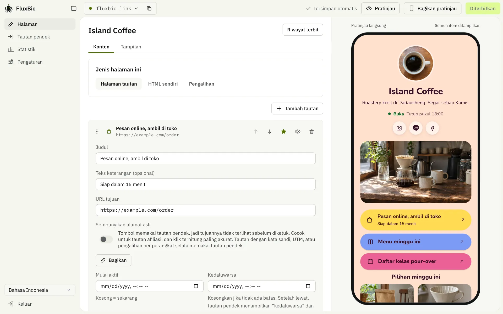
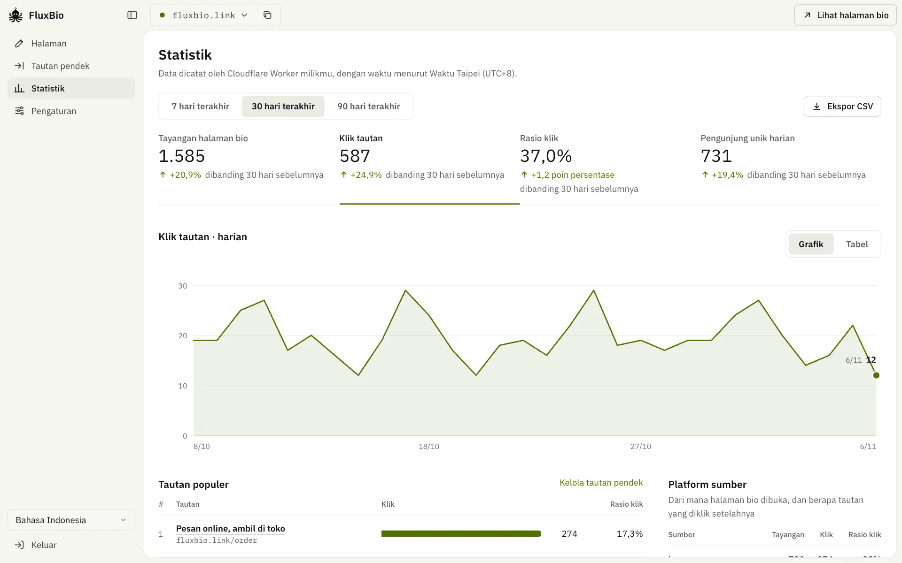
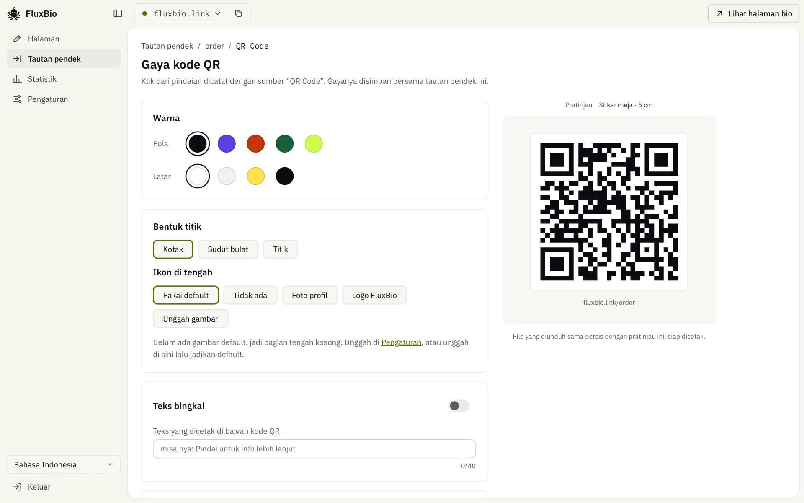

<div align="center">


# FluxBio

**Satu tautan mengalir ke semua tentangmu**

Link in bio + tautan pendek open source yang seluruhnya berjalan di akun Cloudflare-mu sendiri. Paket gratisnya sudah cukup.

<a href="../README.md"><kbd>&nbsp;English&nbsp;</kbd></a>
<a href="README.zh-TW.md"><kbd>&nbsp;繁體中文&nbsp;</kbd></a>
<a href="README.zh-CN.md"><kbd>&nbsp;简体中文&nbsp;</kbd></a>
<a href="README.ja.md"><kbd>&nbsp;日本語&nbsp;</kbd></a>
<a href="README.ko.md"><kbd>&nbsp;한국어&nbsp;</kbd></a>
<a href="README.es.md"><kbd>&nbsp;Español&nbsp;</kbd></a>
<a href="README.pt-BR.md"><kbd>&nbsp;Português&nbsp;</kbd></a>
<a href="README.fr.md"><kbd>&nbsp;Français&nbsp;</kbd></a>
<a href="README.de.md"><kbd>&nbsp;Deutsch&nbsp;</kbd></a>
<a href="README.id.md"><kbd>&nbsp;<b>Bahasa Indonesia</b>&nbsp;</kbd></a>
<a href="README.th.md"><kbd>&nbsp;ไทย&nbsp;</kbd></a>
<a href="README.vi.md"><kbd>&nbsp;Tiếng Việt&nbsp;</kbd></a>
<a href="README.ar.md"><kbd>&nbsp;العربية&nbsp;</kbd></a>

[Halaman perkenalan](https://fluxbio.link) · [Pasang sendiri](#pasang-sendiri) · [Panduan untuk agen AI](../AGENTS.md)

[](../LICENSE)
[](https://workers.cloudflare.com/)

</div>

<br>

**TL;DR**

- Halaman Link-in-bio dan link pendek dengan statistik klik, dalam satu alat.
- Berjalan di akun Cloudflare milikmu sendiri. Paket gratis sudah cukup, dan datamu tetap milikmu.
- [Tempel satu prompt ke AI-mu](#pasang-sendiri), lalu AI menyiapkan semuanya. Setelah itu, edit di dasbor atau cukup minta ke AI-mu.



Buat beberapa halaman bio sesuai gayamu: pilih tema dan warnanya, atau minta AI-mu membuatkan satu dengan gambarmu, dan kamu juga bisa menambahkan video, produk, serta jam buka. Setiap tautan di halaman juga punya tautan pendek, dan kamu bisa melihat apa yang diklik dan apakah pengunjung datang dari IG, Threads, atau LINE.

## Fitur

### Dikelola lewat AI

- Buat token API di Pengaturan, lalu tempel prompt di layar ke Claude Code, Codex, atau Cursor. Setelah itu, tinggal minta untuk mengubah halaman, membuat tautan pendek, melihat statistik, atau mengganti domain dan zona waktu.
- Setiap instalasi dilengkapi panduan untuk AI (`/llms.txt`, `/skill.md`) dan spesifikasi API (`/api/openapi.json`). Sebelum tindakan seperti menerbitkan, menghapus, atau mengubah alamat, AI akan mengingatkan risikonya, dan juga memberi saran.

### Halaman bio

- Satu instalasi bisa mengelola beberapa halaman, masing-masing dengan alamat, tema, dan statistiknya sendiri.
- 24 tema, masing-masing dengan tata letak sendiri dan beberapa set warna: Neon, Panorama, Ubin, Permen, Lapang, Aurora, Kartu, Buram, Senja, Langit, Pop, Potret, Lembar, Rel, Dua warna, Relief, Bento, Titik, Pastel, Surat, Obsidian, Bulan, Cip, dan Trek.
- Hanya butuh tautan pendek? Matikan fitur halaman di dasbor: halaman publik tidak tampil, tautan pendek tetap berfungsi, dan tidak ada yang terhapus.
- Tidak mau halaman tautan? Halaman apa pun bisa berisi HTML sendiri atau dialihkan ke alamat lain, dan keduanya bisa jadi halaman beranda.
- Font: font setiap tema dimuat dari Google Fonts tanpa memakai kuotamu. Satu sakelar di Tampilan membuatnya dikirim dari Worker milikmu, jadi pengunjung tidak pernah terhubung ke Google (berguna jika ada pengunjung dari UE). Untuk font Google Fonts lainnya, minta ke AI-mu; lihat FAQ untuk pemakaian kuotanya.
- Tema milikmu: minta AI-mu membuat satu dengan warna, font, gambar sampul, dan latar belakangmu. [File tema](../themes/) yang dibagikan orang lain juga tinggal diserahkan ke AI.
- Blok konten: tautan, judul, video (YouTube / Vimeo), carousel foto, kartu produk, jam buka & peta.
- Tautan bisa dijadikan unggulan, disembunyikan, atau dijadwalkan kapan tampil dan berakhir.
- Templat: kreator, toko kecil, pendaftaran acara, profesional, organisasi. Mulai dengan satu klik.
- Gambar pratinjau saat halaman dibagikan ke LINE atau Facebook dibuat otomatis sesuai tema. Gambar ini dibuat saat kamu menerbitkan dari dasbor; AI-mu juga bisa memakai tangkapan layar halaman.
- Tombol LINE bisa ditaruh di kanan bawah, jadi pengunjung bisa menambahkanmu dengan sekali ketuk.

### Tautan pendek

- Setiap tautan di halaman bio otomatis menjadi tautan pendek setelah diterbitkan, dan kamu juga bisa membuatnya terpisah. Untuk membuat banyak sekaligus dengan UTM per platform, serahkan ke AI. Tombol di halaman menampilkan alamat asli; satu sakelar menggantinya dengan tautan pendek, untuk tautan yang tidak ingin kamu tampilkan, seperti tautan afiliasi.
- Slug bisa memakai huruf dari bahasa apa pun, termasuk aksara Thai dan Hindi.
- Warna, bentuk titik, ikon di tengah, dan teks bingkai kode QR bisa diganti, lalu diunduh sebagai PNG / SVG / PDF.
- Waktu mulai tampil, tanggal kedaluwarsa, perlindungan kata sandi, UTM.
- Pengalihan pintar: di LINE dibuka di browser eksternal, di browser bawaan IG/FB muncul dulu petunjuk untuk membuka di browser, dan iPhone serta Android bisa diarahkan ke tujuan masing-masing.

### Statistik

- Tayangan, klik, rasio klik, sumber: dihitung tepat dan disimpan selamanya (D1).
- Pengunjung unik, wilayah, peta pengunjung, operator, perangkat, browser, bahasa, situs eksternal, UTM, jam klik, aktivitas terbaru: disimpan 90 hari (Cloudflare Analytics Engine, tanpa perlu diatur).
- Perbandingan dengan periode sebelumnya, halaman statistik sendiri untuk setiap tautan pendek, ekspor CSV.
- Tanpa cookie, tanpa menyimpan IP atau string browser lengkap, dan lokasi hanya sampai kota; ID pengunjung adalah hash satu arah yang berganti setiap hari. Bot juga tidak dihitung.

<table>
  <tr>
    <td width="50%"></td>
    <td width="50%"></td>
  </tr>
  <tr>
    <td align="center"><sub>Statistik, dibandingkan dengan periode sebelumnya</sub></td>
    <td align="center"><sub>Kode QR untuk setiap tautan pendek</sub></td>
  </tr>
</table>

### Bahasa dan hosting

- **13 bahasa**: dasbor dan halaman publik tersedia dalam 繁體中文, 简体中文, English, 日本語, 한국어, Español, Português, Français, Deutsch, Bahasa Indonesia, ไทย, Tiếng Việt, dan العربية. Halaman publik memakai satu bahasa pilihanmu, dan kamu bisa mengaktifkan bahasa lain untuk pengunjung yang browsernya memakai bahasa itu. AI-mu juga bisa menerjemahkan teks buatanmu ke bahasa-bahasa itu.
- **Hampir tanpa JavaScript di halaman publik**: HTML murni yang langsung dikirim dari edge Cloudflare, jadi cepat. Hanya ada satu skrip kecil untuk menghitung klik, dan halaman tetap berfungsi tanpanya. Video dan peta baru dimuat setelah pengunjung mengetuknya.
- **Pasang sendiri**: hanya memakai Workers, D1, KV, dan Analytics Engine dari Cloudflare, semuanya tanpa pengaturan manual, tanpa perlu mendaftar ke layanan lain (font dimuat dari Google Fonts secara bawaan, dan bisa dimatikan). Minta AI mengekspor dan mengimpor seluruh konten sekaligus untuk mencadangkan atau pindah ke instalasi lain.

## Pasang sendiri

AI-mu memasang alat yang dibutuhkan. Untuk mencoba, kamu hanya perlu Claude Code; untuk memublikasikan, perlu juga akun Cloudflare gratis. Kalau mengerjakan sendiri, kamu perlu Node.js 22.23+, 24.22+ atau 26.12+ dan pnpm.

### Cara termudah: serahkan ke AI

Tempel ke AI-mu. Kami menyarankan [Claude Code](https://code.claude.com/docs/en/quickstart) di komputermu sendiri, tetapi Codex, OpenCode, Cursor, dan yang lain yang bisa menjalankan perintah dan terhubung ke internet juga bisa:

```text
Ikuti AGENTS.md di https://github.com/0t2/flux-bio dan bantu aku mencoba FluxBio.
Pakai bahasa Indonesia (id) sebagai bahasa halaman.
```

AI akan bertanya dulu apakah kamu mau melihat halaman contoh di komputermu, tanpa perlu akun. Kalau sudah suka, AI memintamu masuk ke Cloudflare, memublikasikannya, lalu menghubungkan dirinya sendiri. Kamu yang menentukan kapan jadi publik, dan setelah itu tinggal bilang apa yang mau diubah. ChatGPT dan Claude di browser tidak bisa melakukannya, karena tidak bisa menjalankan apa pun di komputermu.

> [!NOTE]
> Di tengah proses, kamu akan dimintai izin beberapa kali: AI bertanya sebelum menjalankan perintah (mengunduh kode, memasang paket, men-deploy), Cloudflare memintamu menyetujui login di browser, dan AI bertanya lagi sebelum menyimpan token-nya di komputermu. Periksa apa yang dilakukan tiap langkah, lalu izinkan.

### Kerjakan sendiri

```sh
git clone https://github.com/0t2/flux-bio.git
cd flux-bio
pnpm install
pnpm exec cf auth login          # pertama kali, masuk ke Cloudflare

# buat kata sandi dasbor (ADMIN_PASSWORD, minimal 12 karakter), lalu deploy
printf 'ADMIN_PASSWORD=%s\n' "$(openssl rand -base64 30 | tr -dc 'A-Za-z0-9' | head -c 24)" > .secrets.env
pnpm exec cf deploy --secrets-file .secrets.env
cat .secrets.env && rm .secrets.env   # simpan kata sandinya baik-baik
```

Setelah deploy selesai, buka `https://<alamat-situsmu>/admin/` dan masuk dengan kata sandi tadi. Penyiapan awal akan memandumu membuat halaman pertama, lalu hubungkan AI-mu di “Pengaturan”; setelah itu domain, zona waktu, cadangan, dan penggantian kata sandi cukup kamu minta ke AI. Deploy pertama otomatis membuat database D1 dan KV.

## Melihat asal pengunjung

FluxBio mencatat dari mana setiap kunjungan datang, tanpa cookie. Di “Statistik”, “Platform sumber” menunjukkan berapa orang yang membuka halaman bio kamu dari tiap platform dan berapa tautan yang mereka klik setelahnya, sedangkan “Kampanye UTM” merincinya menurut tag pada tautanmu.

### Dikenali otomatis

- **Browser dalam aplikasi:** Instagram, Threads, Facebook (termasuk Messenger), LINE, X, TikTok, WeChat, Weibo, KakaoTalk, NAVER, Zalo, Snapchat, Pinterest, dan LinkedIn.
- **Situs perujuk:** X (t.co), YouTube, Reddit, mesin pencari seperti Google, Bing, Yahoo, dan Baidu, serta situs lain mana pun, ditampilkan dengan domainnya.
- **Kode QR** buatan FluxBio otomatis membawa `?s=qr`.
- Tautan di halaman bio meneruskan sumbernya, jadi klik dihitung untuk platform asal pengunjung.

### Perlu kamu tandai sendiri

Beberapa tempat tidak memberi tahu asal kunjungan, sehingga kunjungan itu dihitung sebagai “Langsung/lainnya”:

- WhatsApp, Telegram, Discord, iMessage, dan SMS
- email, newsletter, dan PDF
- poster, kartu nama, dan barang cetak lainnya (pakai kode QR dari FluxBio)

Tambahkan `?s=` dan sebuah nama pada tautan yang kamu bagikan di sana, misalnya `https://links.example.com/?s=whatsapp`, atau `https://links.example.com/talk?s=email` untuk tautan pendek. Singkatan juga bisa: `ig`, `fb`, `x`, `th`, `wa`, `tg`, `mail`, `qr`. Tag `?s=` lebih diutamakan daripada deteksi otomatis.

### Beberapa tempat di satu platform: `utm_content`

Tautan di bio Instagram, story, dan postingan semuanya dihitung sebagai Instagram. Untuk membandingkannya, beri tiap tempat alamatnya sendiri:

- di bio Instagram: `https://links.example.com/?utm_content=bio`
- di story: `https://links.example.com/?utm_content=story`

Masing-masing mendapat baris sendiri di “Kampanye UTM”, dengan tayangan dan klik dihitung terpisah, dan pengunjung tetap membawa tag itu saat mengetuk tautan di halamanmu. Tautan pendek juga bisa diberi `utm_source`, `utm_medium`, `utm_campaign`, dan `utm_content` (“Tautan pendek” → “Pengaturan lanjutan”). Tag ini ditambahkan ke alamat tujuan, jadi situs yang kamu tautkan juga bisa melihatnya.

> [!TIP]
> Atau minta saja ke AI: “Buatkan tautan pelacakan untuk bio Instagram, story, dan postinganku.”

### Perlu diketahui

- Kamu bisa melihat dari mana pengunjung datang, tetapi tidak siapa mereka. Instagram, Facebook, dan X tidak pernah memberi tahu situs lain akun mana yang mengetuk tautan, dan FluxBio tidak menyimpan apa pun yang bisa mengenali seseorang.
- Nama `?s=` hanya boleh berisi huruf, angka, `-`, dan `_`, dan diubah menjadi huruf kecil; karakter lain dibuang. Tag UTM disimpan apa adanya, jadi `story` dan `Story` dihitung sebagai dua baris. Tulis dengan ejaan yang sama setiap kali.
- Lokasi adalah kota yang diperkirakan Cloudflare dari alamat IP pengunjung. VPN, Relai Pribadi iCloud, dan jaringan kantor bisa menempatkan pengunjung di tempat lain.
- Tayangan, klik, dan sumber dihitung persis dan disimpan selamanya. Wilayah, peta, jaringan, perangkat, bahasa, dan rincian UTM disimpan 90 hari, dan kunjungan baru muncul sekitar satu menit kemudian. Kamu bisa memilih apakah ikon sosial ikut dihitung. Tombol yang menampilkan alamat asli dihitung oleh skrip kecil di halaman, jadi pemblokir bisa membuat klik tidak terhitung; tautan pendek selalu terhitung.
- Pengunjung unik dihitung per hari: orang yang sama di dua hari berbeda, atau di ponsel lalu di komputer, dihitung dua kali.
- Bot dan pratinjau tautan (permintaan yang dibuat aplikasi chat saat seseorang menempelkan tautan) tidak dihitung, jadi angkanya bisa lebih kecil daripada di alat lain.
- Tag UTM tautan pendek hanya ditambahkan ke tujuan utamanya, tidak ke alamat terpisah untuk iPhone atau Android, dan tidak pernah menimpa tag yang sudah ada di tujuan. Mengubahnya hanya berlaku untuk klik berikutnya.
- Aplikasi dikenali dari cara browser di dalamnya memperkenalkan diri. Jika sebuah aplikasi mengubahnya, kunjungannya bisa dihitung sebagai “Langsung/lainnya” sampai FluxBio diperbarui.

## Pertanyaan umum

<details>
<summary><b>Apakah berbayar?</b></summary>

FluxBio gratis dan open source. FluxBio berjalan di akun Cloudflare milikmu, yang paket gratisnya cukup untuk puluhan ribu tayangan halaman dan beberapa ratus perubahan per hari. Biasanya itu lebih dari cukup untuk perorangan dan toko kecil. Langganan AI seperti Claude atau ChatGPT terpisah, dan Claude Code memerlukan paket Claude berbayar.

</details>

<details>
<summary><b>Bisa dicoba tanpa akun Cloudflare?</b></summary>

Bisa. AI membuat halaman contoh di komputermu, tanpa akun apa pun. Alamatnya hanya bisa dibuka di komputermu, jadi tidak bisa dikirim ke teman, dan setelah komputer dinyalakan ulang, minta AI membukanya lagi, tidak ada yang hilang. Kalau sudah suka, buat akun Cloudflare gratis untuk memublikasikannya, dan yang sudah kamu buat ikut pindah. Kalau tidak jadi, minta AI menghapus foldernya.

</details>

<details>
<summary><b>Bisakah dipakai tanpa halaman tautan?</b></summary>

Bisa. Halaman apa pun bisa berisi HTML sendiri atau dialihkan ke alamat lain, dan keduanya bisa jadi halaman beranda: minta AI-mu atau pilih di tab Konten halaman itu. Kamu juga bisa mematikan halaman dan hanya memakai tautan pendek.

</details>

<details>
<summary><b>Apa yang terjadi kalau paket gratisnya habis? Apakah aku ditagih?</b></summary>

Kamu tidak akan ditagih. Paket gratis tidak butuh kartu. Kalau jatah hari itu habis, pengunjung melihat pesan galat sampai dihitung ulang pada tengah malam UTC. Kalau AI-mu berjalan di komputermu, AI bisa memberi tahu berapa sisa hari ini.

</details>

<details>
<summary><b>AI-ku terus bertanya boleh menjalankan sesuatu atau tidak. Apa yang harus kutekan?</b></summary>

Itu normal: AI bertanya sebelum melakukan apa pun di komputermu. Kalau untuk mengunduh FluxBio, memasang alat, atau deploy, izinkan saja. Kalau kamu tidak paham apa yang mau dilakukannya, minta penjelasan dulu.

</details>

<details>
<summary><b>Apakah situsku tetap ada saat komputer dimatikan? Bagaimana mengubahnya besok?</b></summary>

Setelah dipublikasikan, tetap ada. Situsmu ada di Cloudflare, bukan di komputermu. Untuk mengubahnya, buka alat AI-mu dan katakan keinginanmu, misalnya “Tambahkan kanal YouTube-ku ke halaman FluxBio”. Claude Code mengingat situsmu; di alat lain, tempel lagi prompt dari Pengaturan.

</details>

<details>
<summary><b>Apakah aku harus punya domain sendiri?</b></summary>

Tidak. Kamu mendapat alamat workers.dev gratis yang langsung berfungsi setelah deploy dan tidak kedaluwarsa. Hanya saja lebih panjang. Kalau nanti kamu punya domain di Cloudflare, kamu bisa menambahkannya, dan tautan yang sudah dibagikan tetap berfungsi.

</details>

<details>
<summary><b>Bagaimana kalau sudah coba dan tidak mau pakai?</b></summary>

Biarkan saja, tidak ada biayanya. Untuk menghapus semuanya, katakan ke AI-mu “Hapus seluruh FluxBio-ku”. AI akan menawarkan cadangan dan memastikan dulu sebelum menghapus apa pun.

</details>

<details>
<summary><b>Bisakah memakai font lain?</b></summary>

Setiap tema punya font sendiri. Untuk font Google Fonts apa saja, minta saja ke AI-mu, misalnya "Ganti judul ke Playfair Display": AI akan mencari font, menjelaskan pemakaian kuotanya, lalu menerbitkan halaman. Secara bawaan font dimuat dari Google Fonts tanpa memakai kuotamu, tetapi browser pengunjung terhubung ke Google; pada 2022 pengadilan Jerman memutuskan bahwa menurut GDPR hal ini butuh persetujuan pengunjung. Jika kamu punya pengunjung dari UE, aktifkan "Muat font dari situsmu sendiri" di Tampilan: saat diterbitkan, hanya huruf yang dipakai halaman yang disalin ke Worker milikmu, dan tiap file font memakai satu permintaan dan satu pembacaan KV per pengunjung baru (font bawaan halaman sudah punya dua atau tiga file). Untuk kebanyakan halaman ini lebih dari cukup; halaman yang ramai dengan font tambahan akan lebih cepat mencapai batas harian, jadi sebaiknya tambahkan paling banyak satu, untuk judul. Kalau kamu mengelola kode FluxBio dengan AI yang bisa mengubahnya, seperti Claude Code, AI itu bisa menekan pemakaian lebih jauh (caranya ada di AGENTS.md).

</details>

<details>
<summary><b>Datanya disimpan di mana?</b></summary>

Semuanya di akun Cloudflare-mu: halaman, tautan pendek, dan statistik di D1, gambar di KV. Tidak ada server pusat, dan pembuatnya tidak bisa melihat datamu. Halaman yang diterbitkan dan tautan pendek bersifat publik. Draf hanya bisa dilihat olehmu dan orang yang punya tautan pratinjau; statistik dan dasbor perlu masuk dulu.

</details>

<details>
<summary><b>Apa bedanya kata sandi dasbor, API token, dan kunci Cloudflare?</b></summary>

**Kata sandi dasbor** dipakai untuk masuk ke dasbor. Kata sandi ini dibuatkan untuk kamu saat deploy dan bisa diganti kapan saja. **API token** untuk AI dan alat lain: buat satu per AI, bisa dibatasi hanya untuk “Buat tautan pendek”, dan bisa dicabut satu per satu tanpa mengganggu yang lain. **Kredensial Cloudflare** dipakai untuk hal yang hanya bisa dilakukan Cloudflare, seperti deploy atau menghubungkan domain. Kredensial ini mengendalikan seluruh akun Cloudflare-mu, jadi jangan ditempel ke obrolan.

</details>

<details>
<summary><b>Bagaimana kalau token bocor?</b></summary>

Cabut token itu di “Pengaturan”, lalu buat yang baru. Kalau yang bocor kata sandi dasbor, minta AI menggantinya; setelah itu semua orang harus masuk ulang, dan semua token juga tidak berlaku lagi.

</details>

<details>
<summary><b>Bagaimana kalau AI salah ubah?</b></summary>

Perubahan halaman masuk ke draf, dan pengunjung tidak melihat apa pun sampai diterbitkan. Pengaturan dan tautan pendek mandiri berubah seketika. Panduan FluxBio meminta AI-mu menjelaskan apa yang akan berubah dan bertanya dulu, menanyakan apakah langsung diterbitkan atau dilihat dulu pratinjaunya, dan menyimpan cadangan sebelum mulai. Kalau ada yang salah, AI bisa mengembalikan salah satu dari 20 versi terbit terakhir sebuah halaman, atau memulihkan cadangan. Alat yang tidak membaca panduan tidak akan melakukan semua ini, jadi beri akses penuh hanya ke AI yang kamu percaya.

</details>

<details>
<summary><b>Bisa dipakai tanpa AI?</b></summary>

Bisa. Mengedit halaman, tampilan, tautan pendek, kode QR, statistik, dan unduhan cadangan semuanya ada di dasbor. Pengaturan seperti domain dan zona waktu, serta tampilan dengan warna dan gambarmu sendiri, tidak punya layar sendiri dan diubah lewat API; panduannya ada di `/llms.txt` setiap FluxBio.

</details>

<details>
<summary><b>AI apa saja yang didukung?</b></summary>

Untuk deploy: kami menyarankan Claude Code di komputermu sendiri, tetapi alat coding lain yang bisa menjalankan perintah dan terhubung ke internet juga bisa, seperti Codex, OpenCode, Cursor, Cline, Roo Code, Kilo Code, Droid, Crush, Goose, Pi, TRAE, Qoder, ZCode, Eigent, Gemini CLI, GitHub Copilot atau Windsurf. Untuk sehari-hari: semua itu, ditambah alat yang bisa memanggil API, seperti aplikasi Claude, Claude Cowork, ChatGPT (GPT kustom), atau n8n. “Pengaturan” di dasbor memberi prompt untuk ditempel ke Claude Code, Codex, atau Cursor; untuk alat lain, arahkan ke /llms.txt situsmu.

</details>

<details>
<summary><b>Bagaimana cara ganti domain, ubah kata sandi, atau pindah ke FluxBio lain?</b></summary>

Cukup bilang ke AI: “Ganti domain ke links.example.com”, “Ganti kata sandi dasborku”, “Pindahkan situs ini ke FluxBio lain”. Domainnya perlu dihubungkan dulu ke Worker ini di Cloudflare, dan AI akan memandumu langkah demi langkah.

</details>

<details>
<summary><b>Apakah pengunjung dilacak?</b></summary>

FluxBio tidak memakai cookie dan tidak menyimpan alamat IP atau string user agent lengkap. Untuk setiap kunjungan, FluxBio menyimpan selama 90 hari waktu, asal pengunjung, perangkat, browser, bahasa, jaringan, dan perkiraan lokasi (paling akurat sekitar 10 km), disertai hash satu arah yang berganti setiap hari. Total disimpan selamanya. Bot yang dikenal dan pratinjau tautan tidak dihitung. Dua hal memang menjangkau Google: font dimuat dari Google Fonts kecuali kamu mematikannya di Tampilan, dan halaman dengan video YouTube memuat gambar mini dari sana.

</details>

## Pengembangan

```sh
cp .dev.vars.example .dev.vars   # atur ADMIN_PASSWORD untuk lokal
pnpm dev                         # http://localhost:5173, dasbor di /admin/
pnpm test                        # jalankan tes di dalam Workers runtime
pnpm typecheck
```

Arsitektur, struktur direktori, dan aturan pengembangan ada di [AGENTS.md](../AGENTS.md).

Teknologi: Cloudflare Workers, D1, KV, Analytics Engine, Hono, React 19, Vite, dan [`cf` CLI](https://www.npmjs.com/package/cf).

## Lisensi

- Program utama: [AGPL-3.0-only](../LICENSE). Kamu bebas memasangnya sendiri dan memodifikasinya; kalau dipakai untuk layanan publik, kode sumber yang sudah dimodifikasi juga harus dibuka.
- `src/templates/` (tema dan renderer halaman publik) dan `themes/` (set warna tema): [MIT](../src/templates/LICENSE), supaya mudah dipakai ulang.
