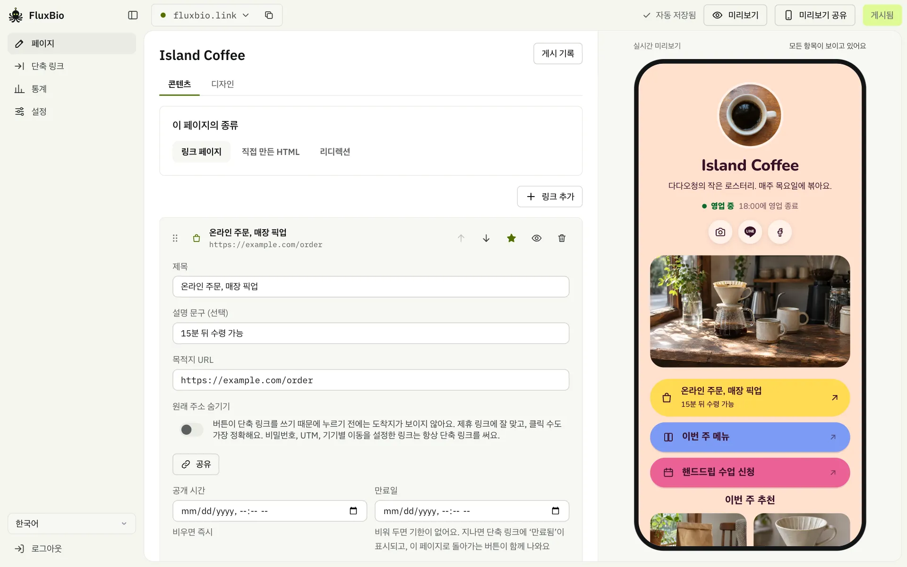
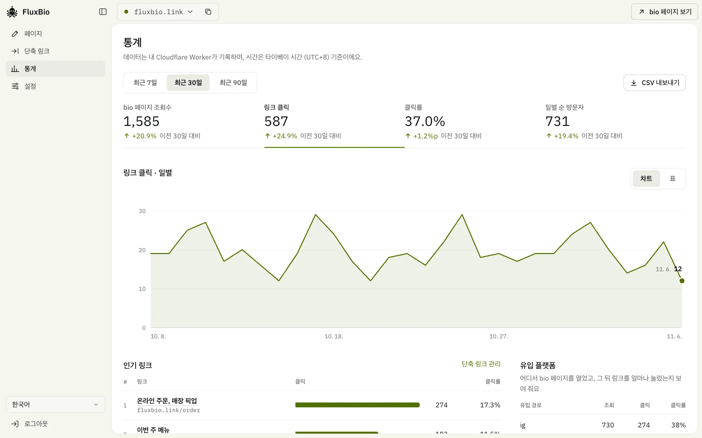
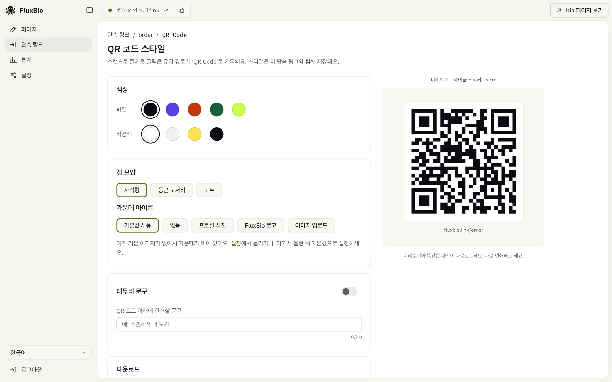

<div align="center">


# FluxBio

**링크 하나로 나의 모든 것을 잇다**

오픈소스 링크인바이오 + 단축 링크예요. 전부 내 Cloudflare 계정에서 돌아가고, 무료 플랜이면 충분해요.

<a href="../README.md"><kbd>&nbsp;English&nbsp;</kbd></a>
<a href="README.zh-TW.md"><kbd>&nbsp;繁體中文&nbsp;</kbd></a>
<a href="README.zh-CN.md"><kbd>&nbsp;简体中文&nbsp;</kbd></a>
<a href="README.ja.md"><kbd>&nbsp;日本語&nbsp;</kbd></a>
<a href="README.ko.md"><kbd>&nbsp;<b>한국어</b>&nbsp;</kbd></a>
<a href="README.es.md"><kbd>&nbsp;Español&nbsp;</kbd></a>
<a href="README.pt-BR.md"><kbd>&nbsp;Português&nbsp;</kbd></a>
<a href="README.fr.md"><kbd>&nbsp;Français&nbsp;</kbd></a>
<a href="README.de.md"><kbd>&nbsp;Deutsch&nbsp;</kbd></a>
<a href="README.id.md"><kbd>&nbsp;Bahasa Indonesia&nbsp;</kbd></a>
<a href="README.th.md"><kbd>&nbsp;ไทย&nbsp;</kbd></a>
<a href="README.vi.md"><kbd>&nbsp;Tiếng Việt&nbsp;</kbd></a>
<a href="README.ar.md"><kbd>&nbsp;العربية&nbsp;</kbd></a>

[소개 페이지](https://fluxbio.link) · [직접 배포하기](#직접-배포하기) · [AI 에이전트용 안내](../AGENTS.md)

[](../LICENSE)
[](https://workers.cloudflare.com/)

</div>

<br>

**TL;DR**

- 링크인바이오 페이지와 단축 링크, 클릭 통계를 하나의 도구로.
- 내 Cloudflare 계정에서 돌아가요. 무료 요금제면 충분하고, 데이터는 내 손에 있어요.
- [AI에게 프롬프트를 붙여 넣으면](#직접-배포하기) 알아서 설치해 줘요. 그다음엔 관리자 페이지에서 고치거나 AI에게 말하면 돼요.



내 스타일대로 bio 페이지를 여러 개 만들어 보세요. 테마와 색 조합을 고르거나 AI에게 내 사진으로 테마를 만들어 달라고 할 수 있고, 동영상, 상품, 영업시간도 넣을 수 있어요. 페이지의 모든 링크에는 단축 링크도 있고, 어떤 링크가 클릭됐는지, IG, Threads, LINE 중 어디서 들어왔는지 볼 수 있어요.

## 기능

### 관리는 AI에게

- 설정에서 API 토큰을 만들고 화면의 프롬프트를 Claude Code, Codex 또는 Cursor에 붙여 넣으세요. 그다음부터는 말로 페이지 수정, 단축 링크 만들기, 통계 확인, 도메인과 시간대 변경을 할 수 있어요.
- 모든 배포에는 AI용 안내(`/llms.txt`, `/skill.md`)와 API 명세(`/api/openapi.json`)가 들어 있어요. AI는 게시, 삭제, 주소 변경 같은 작업 전에 위험을 알려 주고, 제안도 해 줘요.

### bio 페이지

- 하나의 배포에서 여러 페이지를 관리할 수 있고, 페이지마다 주소, 테마, 통계가 따로 있어요.
- 테마 24가지. 각자 고유한 레이아웃과 색 조합이 있어요: 네온, 비스타, 타일, 캔디, 에어리, 오로라, 카드, 프로스트, 선셋, 스카이, 팝, 포트레이트, 시트, 레일, 투톤, 릴리프, 벤토, 도트, 파스텔, 레터, 옵시디언, 문, 칩, 트랙.
- 단축 링크만 필요하다면 대시보드에서 페이지 기능을 끄세요. 공개 페이지는 내려가고 단축 링크는 그대로 작동하며, 데이터는 지워지지 않아요.
- 링크 페이지가 필요 없다면, 어떤 페이지든 직접 만든 HTML로 바꾸거나 다른 주소로 보낼 수 있고, 둘 다 홈페이지로 쓸 수 있어요.
- 글꼴: 테마의 글꼴은 Google Fonts에서 불러와서 한도를 쓰지 않아요. 디자인 페이지의 스위치를 켜면 내 Worker에서 전송해 방문자가 Google에 접속하지 않아요(EU 방문자가 있다면 유용해요). Google Fonts의 다른 글꼴은 AI에게 말하세요. 사용량은 FAQ를 참고하세요.
- 나만의 테마: AI에게 내 색상, 글꼴, 커버 이미지와 배경 이미지로 테마를 만들어 달라고 하면 돼요. 다른 사람이 공유한 [테마 파일](../themes/)도 AI에게 적용해 달라고 하면 돼요.
- 콘텐츠 블록: 링크, 소제목, 동영상(YouTube/Vimeo), 사진 슬라이드, 상품 카드, 영업시간과 지도.
- 링크를 추천으로 설정하거나 숨기고, 표시 기간을 예약할 수 있어요.
- 템플릿: 크리에이터, 가게, 이벤트 신청, 전문가, 단체 중 하나로 바로 시작해요.
- LINE, Facebook에 공유할 때 보이는 미리보기 이미지는 테마에 맞게 자동으로 만들어져요. 이 이미지는 대시보드에서 게시할 때 만들어져요. AI에게 페이지 스크린샷을 쓰게 할 수도 있어요.
- 오른쪽 아래에 LINE 버튼을 둘 수 있어서, 방문자가 한 번에 친구로 추가할 수 있어요.

### 단축 링크

- bio 페이지의 모든 링크는 게시하면 자동으로 단축 링크가 되고, 따로 만들 수도 있어요. 여러 개를 한꺼번에 만들거나 플랫폼별로 UTM을 붙이는 건 AI에게 맡기세요. 페이지의 버튼은 원래 주소를 보여 줘요. 제휴 링크처럼 주소를 드러내고 싶지 않다면 스위치 하나로 단축 링크로 바꿀 수 있어요.
- 슬러그에는 한글을 비롯해 어떤 언어의 문자든 쓸 수 있어요(태국어, 힌디어도요).
- QR 코드는 색상, 점 모양, 가운데 아이콘, 테두리 문구를 바꿀 수 있고, PNG/SVG/PDF로 다운로드할 수 있어요.
- 공개 시간, 만료일, 비밀번호 보호, UTM.
- 스마트 리디렉션: LINE에서는 외부 브라우저로 열고, IG/FB 인앱 브라우저에서는 외부 브라우저 안내를 먼저 보여 주고, iPhone과 Android는 각각 다른 곳으로 보내요.

### 통계

- 조회수, 클릭 수, 클릭률, 유입 경로: 정확하게 세고 영구 보관해요(D1).
- 순 방문자, 지역, 방문자 지도, 통신사, 기기, 브라우저, 언어, 외부 사이트, UTM, 클릭 시간대, 최근 활동: 90일 동안 보관해요(Cloudflare Analytics Engine, 설정 불필요).
- 이전 기간과 비교, 단축 링크별 통계 페이지, CSV 내보내기.
- 쿠키를 쓰지 않고, IP와 브라우저 User-Agent 전체 문자열을 저장하지 않아요. 위치는 도시까지만 기록해요. 방문자 ID는 매일 바뀌는 단방향 해시예요. 봇도 세지 않아요.

<table>
  <tr>
    <td width="50%"></td>
    <td width="50%"></td>
  </tr>
  <tr>
    <td align="center"><sub>이전 기간과 비교한 통계</sub></td>
    <td align="center"><sub>단축 링크마다 QR 코드</sub></td>
  </tr>
</table>

### 언어와 호스팅

- **13개 언어**: 관리자 페이지와 공개 페이지 모두 繁體中文, 简体中文, English, 日本語, 한국어, Español, Português, Français, Deutsch, Bahasa Indonesia, ไทย, Tiếng Việt, العربية를 지원해요. 공개 페이지는 고른 언어 하나로 보여 주고, 다른 언어도 켜 두면 브라우저가 그 언어인 방문자에게 자동으로 바뀌어요. 직접 쓴 내용도 AI에게 그 언어들로 번역을 맡길 수 있어요.
- **JavaScript가 거의 없는 공개 페이지**: 순수 HTML을 Cloudflare 엣지에서 바로 내보내서 빨라요. 클릭을 세는 작은 스크립트 하나만 있고, 없어도 페이지는 잘 돌아가요. 동영상과 지도는 방문자가 눌러야 불러와요.
- **셀프 호스팅**: Cloudflare의 Workers, D1, KV, Analytics Engine만 쓰고, 모두 따로 설정할 필요가 없어요. 다른 서비스에 따로 가입할 필요도 없어요(글꼴은 기본적으로 Google Fonts에서 불러오며, 끌 수 있어요). AI에게 모든 콘텐츠를 통째로 내보내고 가져오게 하면 백업도, 다른 배포로 옮기기도 할 수 있어요.

## 직접 배포하기

필요한 도구는 AI가 설치해 줘요. 써 보는 데는 Claude Code만 있으면 되고, 온라인에 올릴 때 무료 Cloudflare 계정을 준비하면 돼요. 직접 하려면 Node.js(22.23+, 24.22+ 또는 26.12+)와 pnpm이 필요해요.

### 가장 쉬운 방법은 AI에게 맡기는 거예요

AI에 붙여 넣으세요. 내 컴퓨터의 [Claude Code](https://code.claude.com/docs/en/quickstart)를 추천하지만, Codex, OpenCode, Cursor처럼 명령을 실행하고 인터넷에 연결할 수 있는 것도 괜찮아요.

```text
https://github.com/0t2/flux-bio 저장소의 AGENTS.md를 따라 FluxBio를 써 보게 도와주세요.
페이지 언어는 한국어(ko)로 해 주세요.
```

먼저 계정 없이 내 컴퓨터에서 샘플 페이지를 볼지 물어봐요. 마음에 들면 Cloudflare 로그인을 부탁해 온라인에 올리고, 마지막으로 자기 자신을 연결해요. 공개 여부는 내가 정하고, 그다음에는 바꾸고 싶은 걸 말하기만 하면 돼요. 브라우저에서 쓰는 ChatGPT와 Claude로는 할 수 없어요. 내 컴퓨터에서 명령을 실행할 수 없기 때문이에요.

> [!NOTE]
> 진행 중에 몇 번 허락을 구해요. AI는 명령을 실행하기 전(코드 내려받기, 패키지 설치, 배포)에 먼저 묻고, Cloudflare 로그인은 브라우저에서 직접 승인해요. 마지막으로 토큰을 컴퓨터에 저장하기 전에도 한 번 더 물어봐요. 각 단계가 무엇을 하는지 확인한 다음 허락하세요.

### 직접 하려면

```sh
git clone https://github.com/0t2/flux-bio.git
cd flux-bio
pnpm install
pnpm exec cf auth login          # 처음 한 번은 Cloudflare에 로그인

# 관리자 비밀번호(ADMIN_PASSWORD, 12자 이상)를 만든 다음 배포
printf 'ADMIN_PASSWORD=%s\n' "$(openssl rand -base64 30 | tr -dc 'A-Za-z0-9' | head -c 24)" > .secrets.env
pnpm exec cf deploy --secrets-file .secrets.env
cat .secrets.env && rm .secrets.env   # 비밀번호를 잘 보관해 두세요
```

배포가 끝나면 `https://<내 사이트 주소>/admin/`에 접속해서 비밀번호로 로그인하세요. 초기 설정에서 첫 페이지를 만들고 ‘설정’에서 AI를 연결해요. 그다음부터는 도메인, 시간대, 백업, 비밀번호 변경도 AI에게 말하면 돼요. D1 데이터베이스와 KV는 첫 배포 때 자동으로 만들어져요.

## 방문자 유입 경로 보기

FluxBio는 쿠키 없이 방문마다 어디서 왔는지 기록해요. 「통계」 페이지의 「유입 플랫폼」에서 플랫폼별로 몇 명이 bio 페이지를 열었고 그 뒤 링크를 몇 번 눌렀는지 볼 수 있고, 「UTM 캠페인」에서는 링크에 붙인 태그별로 더 자세히 나눠 볼 수 있어요.

### 자동으로 알아보는 곳

- **앱 내 브라우저**: Instagram, Threads, Facebook(Messenger 포함), LINE, X, TikTok, WeChat, Weibo, 카카오톡, NAVER, Zalo, Snapchat, Pinterest, LinkedIn.
- **링크를 건 사이트**: X(t.co), YouTube, Reddit, Google·Bing·Yahoo·Baidu 같은 검색 엔진, 그 밖의 모든 사이트(도메인으로 표시).
- FluxBio에서 만든 **QR 코드**에는 `?s=qr`가 자동으로 붙어요.
- bio 페이지의 링크는 유입 경로를 이어받기 때문에, 클릭은 방문자가 원래 온 플랫폼으로 집계돼요.

### 직접 태그를 붙여야 하는 곳

다음 같은 곳은 어디서 왔는지 알려 주지 않아서 「직접/기타」로 집계돼요.

- WhatsApp, Telegram, Discord, iMessage, 문자 메시지
- 이메일, 뉴스레터, PDF
- 포스터, 명함 같은 인쇄물(FluxBio QR 코드를 쓰세요)

공유하는 주소 끝에 `?s=`와 이름을 붙이세요. 예: `https://links.example.com/?s=whatsapp`, 단축 링크라면 `https://links.example.com/talk?s=email`. `ig`, `fb`, `x`, `th`, `wa`, `tg`, `mail`, `qr` 같은 줄임말도 쓸 수 있어요. `?s=`를 붙이면 자동 판별보다 그쪽이 우선이에요.

### 한 플랫폼 안의 여러 위치: `utm_content`

Instagram 프로필 링크, 스토리, 게시물은 모두 Instagram으로 집계돼요. 비교하고 싶다면 위치마다 다른 주소를 쓰세요.

- Instagram 프로필: `https://links.example.com/?utm_content=bio`
- 스토리: `https://links.example.com/?utm_content=story`

각각 「UTM 캠페인」에서 따로 한 줄씩 보이고, 조회와 클릭은 나눠서 집계돼요. 방문자가 bio 페이지에서 링크를 누를 때도 이 태그가 이어져요. 단축 링크에도 `utm_source`, `utm_medium`, `utm_campaign`, `utm_content`를 설정할 수 있어요(「단축 링크」 페이지의 「고급 설정」). 이 태그는 도착 주소에 붙기 때문에 링크를 건 상대 사이트에서도 볼 수 있어요.

> [!TIP]
> AI에게 「Instagram 프로필, 스토리, 게시물용 추적 링크를 하나씩 만들어 줘」라고 해도 돼요.

### 알아 두세요

- 어디서 왔는지는 알 수 있지만 누구인지는 알 수 없어요. Instagram, Facebook, X는 링크를 누른 계정을 다른 사이트에 알려 주지 않고, FluxBio도 개인을 알아볼 수 있는 데이터는 저장하지 않아요.
- `?s=` 이름에는 영문자, 숫자, `-`, `_`만 쓸 수 있고 소문자로 바뀌어요. 그 밖의 문자(한글 포함)는 지워져요. UTM 태그는 쓴 그대로 기록되므로 `story`와 `Story`는 서로 다른 줄로 집계돼요. 매번 같은 철자로 쓰세요.
- 지역은 방문자의 IP 주소로 Cloudflare가 추정한 도시예요. VPN, iCloud 비공개 릴레이, 회사 네트워크를 쓰는 사람은 다른 곳으로 표시될 수 있어요.
- 조회수, 클릭수, 유입 경로는 정확한 숫자이고 계속 보관돼요. 지역, 지도, 통신사, 기기, 언어, UTM 세부 정보는 90일 동안 보관되고, 새 방문은 1분쯤 뒤에 나타나요. 소셜 아이콘도 셀지는 직접 고를 수 있어요. 원래 주소를 보여 주는 버튼은 페이지의 작은 스크립트로 클릭을 세기 때문에, 차단되면 집계되지 않을 수 있어요. 단축 링크는 모두 집계돼요.
- 순 방문자는 하루 단위로 세요. 같은 사람이 다른 날 다시 오거나 휴대폰으로 왔다가 컴퓨터로 오면 두 명으로 집계돼요.
- 봇과 링크 미리보기(채팅 앱에 링크를 붙여 넣을 때 앱이 미리보기를 가져가는 요청)는 세지 않아서, 다른 도구보다 숫자가 적게 나올 수 있어요.
- 단축 링크의 UTM 태그는 기본 도착 주소에만 붙고, 따로 설정한 iPhone/Android 주소에는 붙지 않아요. 도착 주소에 원래 있던 태그를 덮어쓰지도 않아요. 태그를 바꾸면 그 뒤의 클릭부터 반영돼요.
- 앱은 앱 내 브라우저가 스스로 밝히는 정보로 알아봐요. 앱이 이를 바꾸면 FluxBio가 업데이트될 때까지 「직접/기타」로 집계될 수 있어요.

## 자주 묻는 질문

<details>
<summary><b>비용이 드나요?</b></summary>

FluxBio는 무료 오픈소스이고, 내 Cloudflare 계정에서 돌아가요. Cloudflare 무료 플랜은 하루에 페이지 조회 수만 번과 수정 수백 번을 감당할 수 있어서, 개인이나 작은 가게에는 보통 충분해요. Claude나 ChatGPT 같은 AI 구독료는 별도이고, Claude Code는 Claude 유료 플랜이 필요해요.

</details>

<details>
<summary><b>Cloudflare 계정 없이 먼저 써 볼 수 있나요?</b></summary>

네. AI가 내 컴퓨터에 샘플 페이지를 만들어 주고, 계정은 전혀 필요 없어요. 이 주소는 내 컴퓨터에서만 열리기 때문에 친구에게 보낼 수는 없어요. 컴퓨터를 다시 켠 뒤에는 AI에게 다시 열어 달라고 하면 되고, 데이터는 그대로예요. 마음에 들면 무료 Cloudflare 계정을 만들어 온라인에 올리고, 만든 페이지도 함께 옮겨요. 그만두려면 AI에게 폴더를 지워 달라고 하면 돼요.

</details>

<details>
<summary><b>링크 인 바이오 없이 쓸 수 있나요?</b></summary>

네. 어떤 페이지든 직접 만든 HTML로 바꾸거나 다른 주소로 보낼 수 있고, 둘 다 홈페이지로 쓸 수 있어요. AI에게 부탁하거나 해당 페이지의 콘텐츠 탭에서 고르세요. 페이지 기능을 끄고 단축 링크만 쓸 수도 있어요.

</details>

<details>
<summary><b>무료 사용량을 다 쓰면 어떻게 되나요? 요금이 나오나요?</b></summary>

요금은 나오지 않아요. 무료 플랜은 카드 등록이 필요 없어요. 그날 사용량을 다 쓰면 오전 9시(한국 시간)에 다시 시작될 때까지 방문자에게 오류가 보여요. AI가 내 컴퓨터에서 돌아가고 있다면 오늘 남은 양을 물어볼 수 있어요.

</details>

<details>
<summary><b>AI가 계속 실행해도 되냐고 물어요. 뭘 눌러야 하나요?</b></summary>

정상이에요. AI는 내 컴퓨터에서 무언가를 하기 전에 항상 물어봐요. FluxBio 다운로드, 도구 설치, 배포라면 허용하면 돼요. 무슨 일인지 모르겠으면 먼저 설명해 달라고 하세요.

</details>

<details>
<summary><b>컴퓨터를 꺼도 사이트는 그대로인가요? 내일 수정하려면요?</b></summary>

온라인에 올린 뒤에는 그대로예요. 사이트는 내 컴퓨터가 아니라 Cloudflare에 있어요. 수정할 때는 AI 도구를 열고 “내 YouTube 채널을 FluxBio 페이지에 추가해 줘”처럼 말하면 돼요. Claude Code는 내 사이트를 기억하고, 다른 도구에서는 ‘설정’의 프롬프트를 다시 붙여 넣어야 해요.

</details>

<details>
<summary><b>내 도메인이 꼭 있어야 하나요?</b></summary>

아니요. 배포하면 바로 쓸 수 있는 무료 workers.dev 주소가 생기고, 만료되지 않아요. 조금 길 뿐이에요. 나중에 Cloudflare에 도메인이 생기면 언제든 추가할 수 있고, 이미 공유한 링크도 계속 작동해요.

</details>

<details>
<summary><b>써 보고 안 쓰기로 하면요?</b></summary>

그냥 두어도 돈이 들지 않아요. 모두 지우려면 AI에게 “FluxBio를 전부 삭제해 줘”라고 말하세요. 백업을 남길지 묻고, 확인한 뒤에 삭제해요.

</details>

<details>
<summary><b>다른 글꼴도 쓸 수 있나요?</b></summary>

테마마다 고유한 글꼴이 있어요. Google Fonts의 다른 글꼴을 쓰고 싶으면 AI에게 "제목을 Playfair Display로 바꿔 줘"처럼 말하세요. 글꼴을 찾고 사용량을 설명한 뒤 페이지를 게시해 줘요. 글꼴은 기본적으로 Google Fonts에서 불러와 한도를 쓰지 않지만, 방문자의 브라우저가 Google에 접속해요. 2022년 독일 법원은 GDPR상 이 경우 방문자의 동의가 필요하다고 판결했어요. EU 방문자가 있다면 디자인 페이지에서 '글꼴을 내 사이트에서 불러오기'를 켜세요. 게시할 때 페이지에 쓰인 글자만 내 Worker로 복사하고, 글꼴 파일 하나당 새 방문자마다 요청 1건과 KV 읽기 1회가 들어요(기본 글꼴만으로도 파일 2~3개). 대부분의 페이지에는 충분하지만, 방문자가 많은 페이지에 글꼴을 더하면 하루 한도에 더 빨리 닿으니 추가는 제목용으로 하나까지를 권해요. Claude Code처럼 코드를 고칠 수 있는 AI로 FluxBio 코드를 관리한다면 사용량을 더 줄일 수 있어요(방법은 AGENTS.md에 있어요).

</details>

<details>
<summary><b>데이터는 어디에 저장되나요?</b></summary>

전부 내 Cloudflare 계정에 있어요. 페이지, 단축 링크, 통계는 D1에, 이미지는 KV에 저장돼요. 중앙 서버가 없어서 만든 사람도 내 데이터를 볼 수 없어요. 게시한 페이지와 단축 링크는 공개돼요. 초안은 나와 미리보기 링크를 받은 사람만 볼 수 있고, 통계와 관리자 페이지는 로그인해야 볼 수 있어요.

</details>

<details>
<summary><b>관리자 비밀번호, API token, Cloudflare 키는 뭐가 다른가요?</b></summary>

**관리자 비밀번호**는 관리자 페이지에 로그인할 때 써요. 배포할 때 자동으로 만들어지고, 나중에 언제든 바꿀 수 있어요. **API token**은 AI와 도구용이에요. AI마다 하나씩 발급하고, ‘단축 링크 만들기만 가능’ 권한만 줄 수도 있고, 하나만 따로 폐기해도 다른 곳에는 영향이 없어요. **Cloudflare 키**는 배포나 도메인 연결처럼 Cloudflare에서만 할 수 있는 일에만 써요. Cloudflare 계정 전체를 다루는 키라서 채팅에 붙여 넣으면 안 돼요.

</details>

<details>
<summary><b>token이 유출되면 어떻게 하나요?</b></summary>

‘설정’에서 그 token을 폐기하고 새로 발급하세요. 관리자 비밀번호가 유출됐다면 AI에게 비밀번호 변경을 부탁하세요. 바꾸고 나면 모두 다시 로그인해야 하고, 모든 token도 무효가 돼요.

</details>

<details>
<summary><b>AI가 잘못 바꾸면요?</b></summary>

페이지 수정은 먼저 초안으로 저장되고, 게시하기 전에는 방문자에게 아무것도 보이지 않아요. 설정과 단독 단축 링크는 바로 바뀌어요. FluxBio의 가이드에 따라 AI는 바뀌는 내용을 설명하고 먼저 물어보며, 바로 게시할지 미리보기를 먼저 볼지 묻고, 시작하기 전에 백업을 해 둬요. 잘못됐을 때는 페이지의 최근 게시본 20개 중 하나로 되돌리거나 백업에서 복원할 수 있어요. 가이드를 읽지 않는 도구는 이렇게 하지 않으니, 모든 권한은 믿을 수 있는 AI에게만 주세요.

</details>

<details>
<summary><b>AI 없이도 쓸 수 있나요?</b></summary>

네. 페이지 편집, 디자인, 단축 링크, QR 코드, 통계, 백업 다운로드는 모두 관리자 페이지에 있어요. 도메인, 시간대 같은 설정과 내 색상·이미지를 쓰는 디자인은 화면이 없어서 API로 바꿔야 해요. 방법은 각 FluxBio의 `/llms.txt`에 있어요.

</details>

<details>
<summary><b>어떤 AI를 지원하나요?</b></summary>

배포에는 내 컴퓨터의 Claude Code를 추천해요. 명령을 실행하고 인터넷에 연결할 수 있는 다른 코딩 도구(Codex, OpenCode, Cursor, Cline, Roo Code, Kilo Code, Droid, Crush, Goose, Pi, TRAE, Qoder, ZCode, Eigent, Gemini CLI, GitHub Copilot, Windsurf 등)도 괜찮아요. 일상 관리에는 여기에 더해 API를 호출할 수 있는 도구(Claude 앱, Claude Cowork, ChatGPT 맞춤형 GPT, n8n 등)도 쓸 수 있어요. 관리자 페이지 ‘설정’에 Claude Code, Codex, Cursor에 붙여 넣을 프롬프트가 있어요. 그 밖의 도구에는 내 사이트의 /llms.txt를 읽게 하세요.

</details>

<details>
<summary><b>도메인이나 비밀번호를 바꾸거나 다른 곳으로 옮기려면요?</b></summary>

AI에게 말하면 돼요. “도메인을 links.example.com으로 바꿔 주세요”, “관리자 비밀번호를 바꿔 주세요”, “사이트를 다른 FluxBio로 옮겨 주세요”처럼요. 도메인은 먼저 Cloudflare에서 이 Worker에 연결해야 하는데, AI가 하나씩 안내해 줘요.

</details>

<details>
<summary><b>방문자를 추적하나요?</b></summary>

FluxBio는 쿠키를 쓰지 않고, IP 주소와 브라우저 User-Agent 전체 문자열도 저장하지 않아요. 방문할 때마다 시각, 유입 경로, 기기, 브라우저, 언어, 네트워크, 대략적인 위치(가장 정확해야 약 10km)를 90일 동안 보관하고, 매일 바뀌는 단방향 해시를 함께 붙여요. 합계는 계속 남아요. 알려진 봇과 링크 미리보기는 집계하지 않아요. Google에 연결되는 경우가 두 가지 있어요. 글꼴은 ‘디자인’에서 끄지 않으면 Google Fonts에서 불러오고, YouTube 영상이 있는 페이지는 썸네일도 거기서 불러와요.

</details>

## 개발

```sh
cp .dev.vars.example .dev.vars   # 로컬용 ADMIN_PASSWORD 설정
pnpm dev                         # http://localhost:5173 , 관리자 페이지는 /admin/
pnpm test                        # Workers 런타임에서 테스트 실행
pnpm typecheck
```

아키텍처, 디렉터리 구조, 개발 규칙은 [AGENTS.md](../AGENTS.md)에 있어요.

기술: Cloudflare Workers, D1, KV, Analytics Engine, Hono, React 19, Vite, 그리고 [`cf` CLI](https://www.npmjs.com/package/cf).

## 라이선스

- 본체: [AGPL-3.0-only](../LICENSE). 자유롭게 셀프 호스팅하고 수정할 수 있어요. 공개 서비스로 제공할 때는 수정한 소스 코드도 공개해야 해요.
- `src/templates/`(공개 페이지 테마와 렌더러)와 `themes/`(테마 색 조합): 재사용하기 쉽도록 [MIT](../src/templates/LICENSE)예요.
