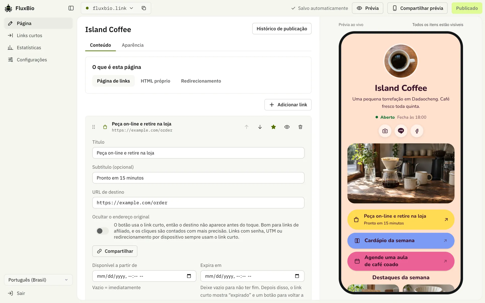
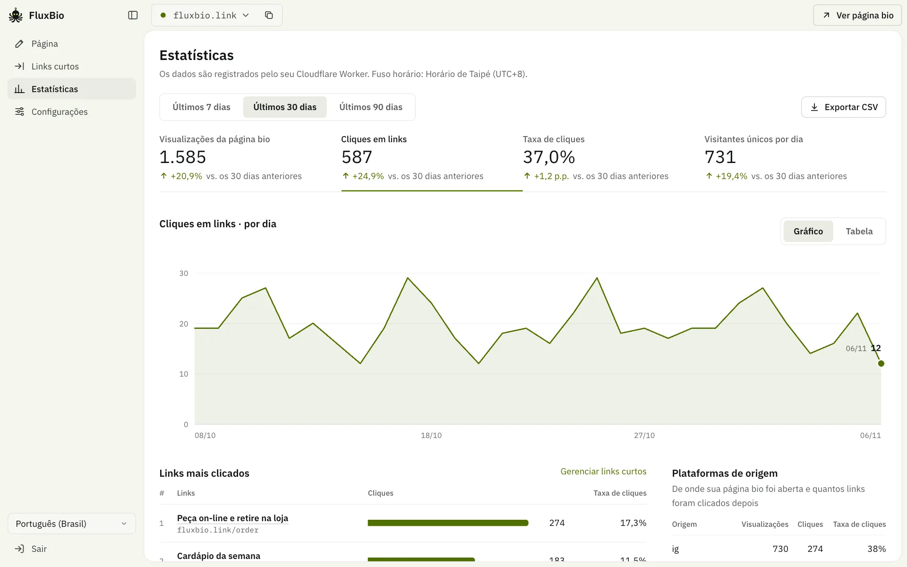
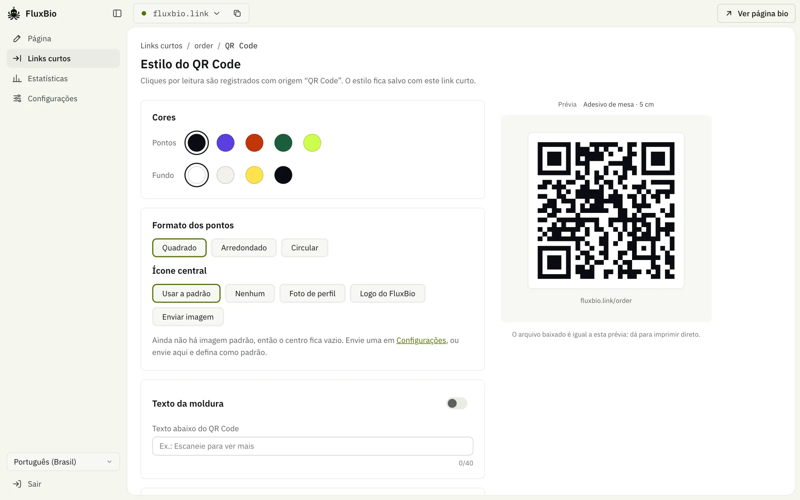

<div align="center">


# FluxBio

**Um só link para tudo o que você faz**

Link na bio e links curtos de código aberto, rodando inteiro na sua própria conta da Cloudflare. O plano gratuito dá conta.

<a href="../README.md"><kbd>&nbsp;English&nbsp;</kbd></a>
<a href="README.zh-TW.md"><kbd>&nbsp;繁體中文&nbsp;</kbd></a>
<a href="README.zh-CN.md"><kbd>&nbsp;简体中文&nbsp;</kbd></a>
<a href="README.ja.md"><kbd>&nbsp;日本語&nbsp;</kbd></a>
<a href="README.ko.md"><kbd>&nbsp;한국어&nbsp;</kbd></a>
<a href="README.es.md"><kbd>&nbsp;Español&nbsp;</kbd></a>
<a href="README.pt-BR.md"><kbd>&nbsp;<b>Português</b>&nbsp;</kbd></a>
<a href="README.fr.md"><kbd>&nbsp;Français&nbsp;</kbd></a>
<a href="README.de.md"><kbd>&nbsp;Deutsch&nbsp;</kbd></a>
<a href="README.id.md"><kbd>&nbsp;Bahasa Indonesia&nbsp;</kbd></a>
<a href="README.th.md"><kbd>&nbsp;ไทย&nbsp;</kbd></a>
<a href="README.vi.md"><kbd>&nbsp;Tiếng Việt&nbsp;</kbd></a>
<a href="README.ar.md"><kbd>&nbsp;العربية&nbsp;</kbd></a>

[Página de apresentação](https://fluxbio.link) · [Monte o seu](#monte-o-seu) · [Guia para agentes de IA](../AGENTS.md)

[](../LICENSE)
[](https://workers.cloudflare.com/)

</div>

<br>

**TL;DR**

- Páginas Link-in-bio e links curtos com estatísticas de cliques, em uma só ferramenta.
- Roda na sua própria conta da Cloudflare. O plano gratuito basta, e seus dados continuam seus.
- [Cole um texto na sua IA](#monte-o-seu) e ela configura tudo. Depois, edite no painel ou simplesmente peça à sua IA.



Crie páginas bio com a sua cara: escolha um tema e suas cores, ou peça à sua IA um com as suas imagens, e adicione vídeos, produtos e horário de funcionamento. Cada link da página também tem seu link curto, e você vê o que recebe cliques e se as pessoas vieram do IG, do Threads ou do LINE.

## Recursos

### Sua IA cuida de tudo

- Crie um token de API em Configurações e cole o prompt da tela no Claude Code, Codex ou Cursor. A partir daí, é só pedir para editar páginas, criar links curtos, ver estatísticas ou mudar o domínio e o fuso horário.
- Toda instalação vem com um guia para a IA (`/llms.txt`, `/skill.md`) e a especificação da API (`/api/openapi.json`). A IA avisa dos riscos antes de publicar, excluir ou mudar um endereço, e também dá sugestões.

### Páginas bio

- Uma instalação pode ter várias páginas, cada uma com seu próprio endereço, tema e estatísticas.
- 24 temas, cada um com seu próprio layout e algumas combinações de cores: Neon, Panorama, Blocos, Doce, Arejado, Aurora, Cartão, Fosco, Pôr do sol, Céu, Pop, Retrato, Folha, Trilho, Duas cores, Relevo, Bentô, Pontos, Pastel, Carta, Obsidiana, Lua, Etiquetas e Faixas.
- Só precisa de links curtos? Desligue as páginas no painel: as páginas públicas saem do ar, os links curtos continuam funcionando e nada é apagado.
- Não quer uma página de links? Qualquer página pode ser seu próprio HTML ou redirecionar para outro endereço, e ambas podem ser sua página inicial.
- Fontes: as de cada tema carregam do Google Fonts sem usar a sua cota. Um botão em Aparência passa a servi-las do seu próprio Worker, e os visitantes nunca se conectam ao Google (útil se você tem visitantes na UE). Para qualquer outra fonte do Google Fonts, peça à sua IA; veja nas perguntas frequentes quanto elas consomem.
- Seu próprio tema: peça à sua IA um com suas cores, fontes, imagem de capa e fundo. Os [arquivos de tema](../themes/) que outras pessoas compartilham também podem ir para a sua IA.
- Blocos de conteúdo: links, títulos, vídeos (YouTube/Vimeo), carrossel de fotos, cards de produtos, horário de funcionamento e mapa.
- Os links podem ficar em destaque, ser ocultados ou ter data marcada para entrar e sair do ar.
- Modelos para criadores, lojas, eventos, profissionais e organizações: comece com um clique.
- A imagem de prévia que aparece ao compartilhar no LINE ou no Facebook é gerada automaticamente de acordo com o tema. Ela é gerada ao publicar pelo painel; sua IA também pode usar uma captura de tela da página.
- Dá para colocar um botão do LINE no canto inferior direito, para adicionarem você com um toque.

### Links curtos

- Ao publicar, cada link da página bio vira um link curto, e você também pode criar links avulsos. Para criar vários de uma vez, com UTM para cada plataforma, peça à sua IA. Os botões da página mostram o endereço real; com um botão de ativar, passam a usar o link curto, para o que você prefere não mostrar, como links de afiliado.
- O apelido aceita letras de qualquer idioma: acentos, ç e também tailandês ou hindi.
- QR Codes com cores, formato dos pontos, ícone central e texto da moldura do seu jeito; baixe em PNG, SVG ou PDF.
- Data de início, data de expiração, proteção por senha e UTM.
- Redirecionamento inteligente: no LINE, abre no navegador externo; no navegador interno do IG e do FB, mostra antes um aviso para sair dele; iPhone e Android podem ir para destinos diferentes.

### Estatísticas

- Visualizações, cliques, taxa de cliques e origem: contagem exata (D1), por dia durante 13 meses e por mês depois disso.
- Visitantes únicos, regiões, mapa de visitantes, operadoras, dispositivos, navegadores, idiomas, sites externos, UTM, cliques por horário e atividade recente: guardados por 90 dias (Cloudflare Analytics Engine, sem configurar nada).
- Comparação com o período anterior, uma página de estatísticas para cada link curto e exportação em CSV.
- Sem cookies e sem guardar IPs ou o user agent completo do navegador, e a localização não passa da cidade; o ID do visitante é um hash de mão única que muda todo dia. Bots também não entram na contagem.

<table>
  <tr>
    <td width="50%"></td>
    <td width="50%"></td>
  </tr>
  <tr>
    <td align="center"><sub>Estatísticas comparadas com o período anterior</sub></td>
    <td align="center"><sub>Um QR code para cada link curto</sub></td>
  </tr>
</table>

### Idiomas e hospedagem

- **13 idiomas**: o painel e as páginas públicas estão em chinês tradicional, chinês simplificado, inglês, japonês, coreano, espanhol, português, francês, alemão, indonésio, tailandês, vietnamita e árabe. As páginas públicas usam o idioma que você escolher, e você pode ativar outros para quem usa o navegador nesses idiomas. Sua IA também pode traduzir seus próprios textos para esses idiomas.
- **Quase nada de JavaScript nas páginas públicas**: HTML puro, servido direto da borda da Cloudflare, então carrega rápido. Só há um script mínimo que conta os cliques, e a página funciona sem ele. Vídeos e mapas só carregam quando o visitante toca neles.
- **Auto-hospedado**: usa só Workers, D1, KV e Analytics Engine da Cloudflare, nada precisa de configuração manual e não é preciso contratar nenhum outro serviço (as fontes vêm do Google Fonts por padrão, e dá para desativar). Peça à sua IA para exportar ou importar todo o conteúdo e fazer um backup ou migrar para outra instalação.

## Monte o seu

Sua IA instala as ferramentas de que precisa. Para experimentar, basta o Claude Code; para colocar no ar, também uma conta gratuita da Cloudflare. Para fazer por conta própria, são necessários Node.js 22.23+, 24.22+ ou 26.12+ e pnpm.

### O jeito mais fácil: peça à sua IA

Cole na sua IA. Recomendamos o [Claude Code](https://code.claude.com/docs/en/quickstart) no seu próprio computador, mas Codex, OpenCode, Cursor e outras que rodam comandos e acessam a internet também servem:

```text
Siga o AGENTS.md de https://github.com/0t2/flux-bio e me ajude a experimentar o FluxBio.
Use português (pt-BR) como idioma da página.
```

Primeiro ela pergunta se você quer ver uma página de exemplo no seu computador, sem precisar de conta. Quando gostar, ela pede para você entrar na Cloudflare, coloca no ar e se conecta. Você decide quando fica pública, e depois é só dizer o que mudar. O ChatGPT e o Claude no navegador não conseguem fazer isso, porque não podem executar nada no seu computador.

> [!NOTE]
> No caminho, você vai autorizar algumas coisas: sua IA pergunta antes de rodar comandos (baixar o código, instalar pacotes, fazer o deploy), a Cloudflare pede que você aprove o login no navegador e sua IA pergunta de novo antes de salvar o token no seu computador. Veja o que cada passo faz e depois autorize.

### Faça você mesmo

```sh
git clone https://github.com/0t2/flux-bio.git
cd flux-bio
pnpm install
pnpm exec cf auth login          # na primeira vez, entre na Cloudflare

# gere a senha do painel (ADMIN_PASSWORD, pelo menos 12 caracteres) e faça o deploy
printf 'ADMIN_PASSWORD=%s\n' "$(openssl rand -base64 30 | tr -dc 'A-Za-z0-9' | head -c 24)" > .secrets.env
pnpm exec cf deploy --secrets-file .secrets.env
cat .secrets.env && rm .secrets.env   # guarde a senha num lugar seguro
```

Quando o deploy terminar, abra `https://<seu-site>/admin/` e entre com a senha. A configuração inicial ajuda você a criar a primeira página; em seguida, conecte sua IA em “Configurações”. Depois disso, domínio, fuso horário, backups e troca de senha é só pedir para ela. O primeiro deploy cria o banco de dados D1 e o KV automaticamente.

## De onde vêm seus visitantes

O FluxBio registra de onde veio cada acesso, sem cookies. Em “Estatísticas”, “Plataformas de origem” mostra quantas pessoas abriram sua página bio a partir de cada plataforma e quantos links elas clicaram depois, e “Campanhas UTM” detalha isso pelas tags dos seus links.

### Reconhecido automaticamente

- **Navegadores dentro de apps:** Instagram, Threads, Facebook (incluindo o Messenger), LINE, X, TikTok, WeChat, Weibo, KakaoTalk, NAVER, Zalo, Snapchat, Pinterest e LinkedIn.
- **Sites que mandam visitantes:** X (t.co), YouTube, Reddit, buscadores como Google, Bing, Yahoo e Baidu, e qualquer outro site, mostrado pelo domínio.
- **QR codes** feitos no FluxBio levam `?s=qr`.
- Os links da sua página bio repassam a origem, então cada clique conta para a plataforma de onde o visitante veio.

### O que você mesmo marca

Alguns lugares não informam de onde veio o acesso, e ele conta como “Direto / outros”:

- WhatsApp, Telegram, Discord, iMessage e SMS
- e-mails, newsletters e PDFs
- cartazes, cartões de visita e outros impressos (use um QR code do FluxBio)

Acrescente `?s=` e um nome ao link que você compartilhar ali, como `https://links.example.com/?s=whatsapp`, ou `https://links.example.com/talk?s=email` para um link curto. As abreviações `ig`, `fb`, `x`, `th`, `wa`, `tg`, `mail` e `qr` também funcionam. Uma tag `?s=` tem prioridade sobre a detecção automática.

### Vários lugares na mesma plataforma: `utm_content`

O link da bio do Instagram, os stories e os posts contam todos como Instagram. Para compará-los, dê a cada lugar um endereço próprio:

- na bio do Instagram: `https://links.example.com/?utm_content=bio`
- em um story: `https://links.example.com/?utm_content=story`

Cada um ganha sua própria linha em “Campanhas UTM”, com visualizações e cliques contados separadamente, e os visitantes mantêm a tag ao tocar em um link da sua página. Links curtos também aceitam `utm_source`, `utm_medium`, `utm_campaign` e `utm_content` (“Links curtos” → “Configurações avançadas”). Eles são acrescentados ao destino, então o site para onde você aponta também os vê.

> [!TIP]
> Ou peça à sua IA: “Crie links de rastreamento para a bio do Instagram, os stories e os posts”.

### Bom saber

- Você vê de onde os visitantes vieram, não quem eles são. Instagram, Facebook e X nunca contam a outros sites qual conta tocou em um link, e o FluxBio não guarda nada que identifique uma pessoa.
- Nomes em `?s=` aceitam letras sem acento, números, `-` e `_`, e ficam em minúsculas; os outros caracteres são removidos. As tags UTM são guardadas como foram escritas, então `story` e `Story` contam como duas linhas: escreva sempre do mesmo jeito.
- A localização é a cidade que a Cloudflare estima a partir do IP do visitante. VPNs, a Retransmissão Privada do iCloud e redes de empresas podem colocar alguém em outro lugar.
- Visualizações, cliques e origens são exatos. Cada dia fica guardado por 13 meses e depois cada mês vira um total, guardado para sempre; nas Configurações dá para baixar tudo. Regiões, mapa, redes, dispositivos, idiomas e detalhes de UTM ficam guardados por 90 dias, e acessos novos levam cerca de um minuto para aparecer. Você escolhe se os ícones sociais também contam. Botões que mostram o endereço real são contados por um script mínimo na página, então um bloqueador pode esconder um clique; links curtos sempre são contados.
- Visitantes únicos são contados por dia: a mesma pessoa em dois dias diferentes, ou no celular e depois no computador, conta duas vezes.
- Bots e prévias de links (o acesso que um app de mensagens faz quando alguém cola um link) não entram na contagem, então os números podem ser menores do que em outras ferramentas.
- As tags UTM de um link curto vão só para o destino principal, não para os endereços separados de iPhone ou Android, e nunca substituem uma tag que o destino já tenha. Alterá-las só afeta os cliques seguintes.
- Os apps são reconhecidos pela forma como seus navegadores internos se identificam. Se um app mudar isso, os acessos dele podem contar como “Direto / outros” até o FluxBio ser atualizado.

## Perguntas frequentes

<details>
<summary><b>Custa alguma coisa?</b></summary>

O FluxBio é gratuito e de código aberto. Ele roda na sua própria conta da Cloudflare, cujo plano gratuito cobre de dez mil a dezenas de milhares de visualizações de página por dia, conforme as imagens da sua página, e algumas centenas de alterações. Isso costuma ser mais do que pessoas e pequenas lojas precisam. Assinaturas de IAs como Claude ou ChatGPT são à parte, e o Claude Code exige um plano pago do Claude.

</details>

<details>
<summary><b>Posso experimentar sem uma conta da Cloudflare?</b></summary>

Sim. Sua IA cria uma página de exemplo no seu computador, sem conta nenhuma. O endereço só abre no seu computador, então não dá para enviar a um amigo, e depois de reiniciar é só pedir à IA para abrir de novo, sem perder nada. Quando gostar, crie uma conta gratuita da Cloudflare para colocar no ar, e o que você fez vai junto. Se preferir desistir, peça à IA para apagar a pasta.

</details>

<details>
<summary><b>Posso usar sem uma página de links?</b></summary>

Sim. Qualquer página pode ser seu próprio HTML ou redirecionar para outro endereço, e ambas podem ser sua página inicial: peça à sua IA ou escolha na aba Conteúdo da página. Você também pode desligar as páginas e usar só links curtos.

</details>

<details>
<summary><b>O que acontece se eu esgotar o plano gratuito? Vou ser cobrado?</b></summary>

Você não será cobrado. O plano gratuito não pede cartão. Se a cota do dia acabar, os visitantes veem um erro até ela reiniciar à meia-noite UTC. Se sua IA roda no seu computador, ela pode dizer quanto resta hoje.

</details>

<details>
<summary><b>Minha IA fica perguntando se pode executar coisas. O que eu aperto?</b></summary>

É normal: ela pergunta antes de fazer qualquer coisa no seu computador. Se for baixar o FluxBio, instalar ferramentas ou implantar, permita. Se não entender o que ela quer fazer, peça uma explicação primeiro.

</details>

<details>
<summary><b>Meu site continua no ar se eu desligar o computador? Como mudo amanhã?</b></summary>

Depois de colocar no ar, sim. Seu site fica na Cloudflare, não no seu computador. Para mudar, abra sua ferramenta de IA e diga o que quer, por exemplo “Adicione meu canal do YouTube à minha página do FluxBio”. O Claude Code lembra do seu site; em outras ferramentas, cole de novo o prompt de Configurações.

</details>

<details>
<summary><b>Preciso ter um domínio próprio?</b></summary>

Não. Você recebe um endereço workers.dev gratuito que funciona assim que é implantado e não expira. Ele só é mais longo. Se mais tarde você tiver um domínio na Cloudflare, pode adicioná-lo, e os links já compartilhados continuam funcionando.

</details>

<details>
<summary><b>E se eu testar e não quiser?</b></summary>

Pode simplesmente deixar lá: não custa nada. Para apagar tudo, diga à sua IA “Apague todo o meu FluxBio”. Ela oferece salvar um backup e confirma com você antes de apagar qualquer coisa.

</details>

<details>
<summary><b>Posso usar outras fontes?</b></summary>

Cada tema tem as próprias fontes. Para qualquer fonte do Google Fonts, peça à sua IA, por exemplo "Troque os títulos para Playfair Display": ela encontra a fonte, diz quanto consome e publica a página. Por padrão as fontes carregam do Google Fonts, sem usar a sua cota, mas os navegadores dos visitantes se conectam ao Google; em 2022 um tribunal alemão decidiu que, pelo GDPR, isso exige o consentimento deles. Se você tem visitantes na UE, ligue "Carregar as fontes do seu site" em Aparência: ao publicar, só os caracteres usados na página são copiados para o seu próprio Worker, e cada arquivo de fonte custa uma requisição e uma leitura no KV por visitante novo (uma página já tem dois ou três por causa da fonte embutida). Para a maioria das páginas sobra; uma página com muito tráfego e fontes extras chega antes ao limite diário, então o ideal é adicionar no máximo uma, para os títulos. Se você gerencia o código do FluxBio com uma IA que pode alterá-lo, como o Claude Code, ela consegue reduzir ainda mais o consumo (o AGENTS.md explica como).

</details>

<details>
<summary><b>Onde ficam os dados?</b></summary>

Tudo fica na sua conta da Cloudflare: páginas, links curtos e estatísticas no D1, imagens no KV. Não existe servidor central, e o autor não consegue ver seus dados. Páginas publicadas e links curtos são públicos. Os rascunhos só você e quem tiver um link de prévia podem ver; estatísticas e painel exigem login.

</details>

<details>
<summary><b>Qual a diferença entre a senha do painel, um token de API e a chave da Cloudflare?</b></summary>

A **senha do painel** é para você entrar no painel: ela é criada para você no deploy e pode ser trocada quando quiser. Os **tokens de API** são para IAs e outras ferramentas: crie um para cada IA, limite um deles a “Só criar links curtos” se quiser e revogue cada um separadamente, sem afetar os outros. As **credenciais da Cloudflare** servem para o que só a Cloudflare pode fazer, como o deploy ou conectar um domínio. Elas controlam a conta inteira da Cloudflare, então nunca cole num chat.

</details>

<details>
<summary><b>E se um token vazar?</b></summary>

Revogue esse token em “Configurações” e crie outro. Se o que vazou foi a senha do painel, peça à sua IA para trocá-la; depois disso, todo mundo precisa entrar de novo e todos os tokens deixam de funcionar.

</details>

<details>
<summary><b>E se a IA errar?</b></summary>

As edições da página vão para um rascunho, e os visitantes não veem nada até ser publicado. As configurações e os links curtos avulsos mudam na hora. O guia do FluxBio manda sua IA explicar o que vai mudar e perguntar antes, perguntar se deve publicar direto ou mostrar uma prévia antes, e salvar um backup antes de começar. Se algo der errado, ela pode restaurar uma das últimas 20 versões publicadas de uma página ou restaurar um backup. Uma ferramenta que não lê o guia não fará nada disso, então dê acesso total só a uma IA em quem você confia.

</details>

<details>
<summary><b>Dá para usar sem IA?</b></summary>

Dá. Páginas, aparência, links curtos, QR Codes, estatísticas e o download de backups ficam no painel. Domínio, fuso horário e uma aparência com suas próprias cores e imagens não têm tela própria e são alterados pela API; as instruções estão no `/llms.txt` de cada FluxBio.

</details>

<details>
<summary><b>Quais IAs funcionam com ele?</b></summary>

Para fazer o deploy: recomendamos o Claude Code no seu próprio computador, mas outras ferramentas de programação que rodam comandos e acessam a internet também servem, como Codex, OpenCode, Cursor, Cline, Roo Code, Kilo Code, Droid, Crush, Goose, Pi, TRAE, Qoder, ZCode, Eigent, Gemini CLI, GitHub Copilot ou Windsurf. Para o dia a dia: essas e qualquer ferramenta que chame APIs, como o app do Claude, Claude Cowork, ChatGPT (com um GPT personalizado) ou n8n. Em “Configurações”, no painel, há um prompt para colar no Claude Code, no Codex ou no Cursor; para qualquer outra ferramenta, aponte para o /llms.txt do seu site.

</details>

<details>
<summary><b>Como mudo o domínio, troco a senha ou migro o site?</b></summary>

É só pedir à sua IA: “Mude o domínio para links.example.com”, “Troque a senha do painel”, “Migre o site para outro FluxBio”. Antes, o domínio precisa estar conectado a este Worker na Cloudflare; a IA guia você passo a passo.

</details>

<details>
<summary><b>Ele rastreia os visitantes?</b></summary>

O FluxBio não usa cookies e não guarda endereços IP nem o user agent completo. De cada visita, guarda por 90 dias o horário, de onde o visitante veio, o dispositivo, o navegador, o idioma, a rede e a localização aproximada (cerca de 10 km, no melhor caso), com um hash de mão única que muda todo dia. Os totais são mantidos para sempre. Bots conhecidos e prévias de links não contam. Duas coisas chegam ao Google: as fontes são carregadas do Google Fonts, a menos que você desative em Aparência, e uma página com vídeo do YouTube carrega a miniatura de lá.

</details>

## Desenvolvimento

```sh
cp .dev.vars.example .dev.vars   # defina o ADMIN_PASSWORD local
pnpm dev                         # http://localhost:5173 , o painel fica em /admin/
pnpm test                        # roda os testes no runtime do Workers
pnpm typecheck
```

Arquitetura, estrutura de pastas e convenções de desenvolvimento estão no [AGENTS.md](../AGENTS.md).

Tecnologias: Cloudflare Workers, D1, KV, Analytics Engine, Hono, React 19, Vite e a [CLI `cf`](https://www.npmjs.com/package/cf).

## Licença

- Programa principal: [AGPL-3.0-only](../LICENSE). Você pode hospedar e modificar à vontade; se usar para oferecer um serviço público, o código-fonte modificado também precisa ser publicado.
- `src/templates/` (os temas e o renderizador das páginas públicas) e `themes/` (combinações de cores dos temas): [MIT](../src/templates/LICENSE), para facilitar o reuso.
