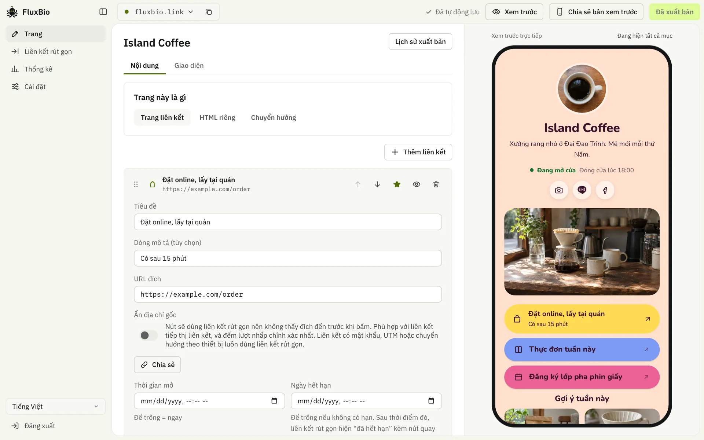
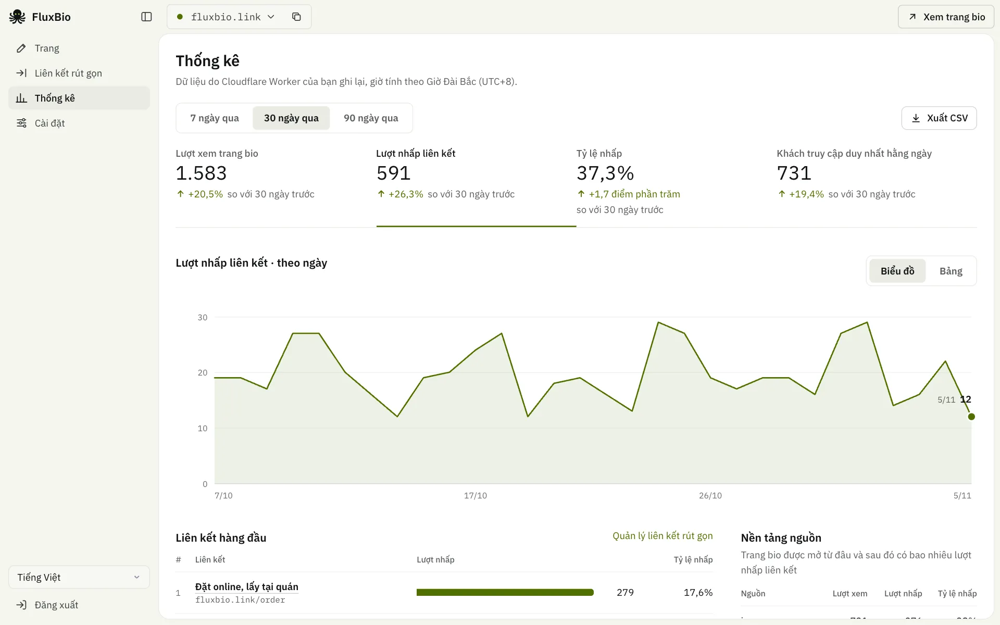
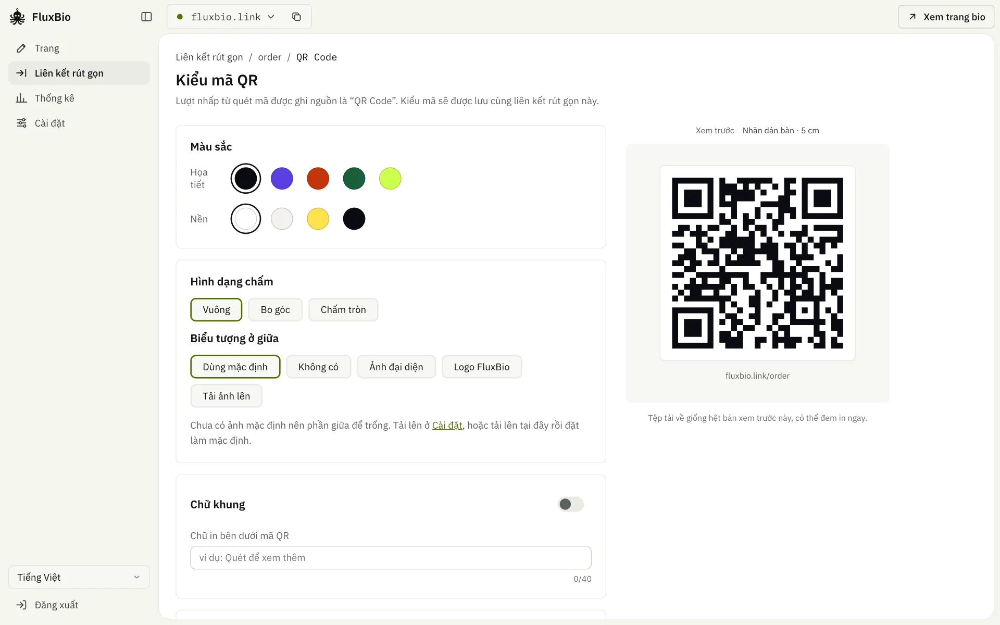

<div align="center">


# FluxBio

**Một liên kết dẫn lối đến mọi điều về bạn**

Link in bio + liên kết rút gọn mã nguồn mở, chạy trọn vẹn trên tài khoản Cloudflare của chính bạn, gói miễn phí là đủ dùng.

<a href="../README.md"><kbd>&nbsp;English&nbsp;</kbd></a>
<a href="README.zh-TW.md"><kbd>&nbsp;繁體中文&nbsp;</kbd></a>
<a href="README.zh-CN.md"><kbd>&nbsp;简体中文&nbsp;</kbd></a>
<a href="README.ja.md"><kbd>&nbsp;日本語&nbsp;</kbd></a>
<a href="README.ko.md"><kbd>&nbsp;한국어&nbsp;</kbd></a>
<a href="README.es.md"><kbd>&nbsp;Español&nbsp;</kbd></a>
<a href="README.pt-BR.md"><kbd>&nbsp;Português&nbsp;</kbd></a>
<a href="README.fr.md"><kbd>&nbsp;Français&nbsp;</kbd></a>
<a href="README.de.md"><kbd>&nbsp;Deutsch&nbsp;</kbd></a>
<a href="README.id.md"><kbd>&nbsp;Bahasa Indonesia&nbsp;</kbd></a>
<a href="README.th.md"><kbd>&nbsp;ไทย&nbsp;</kbd></a>
<a href="README.vi.md"><kbd>&nbsp;<b>Tiếng Việt</b>&nbsp;</kbd></a>
<a href="README.ar.md"><kbd>&nbsp;العربية&nbsp;</kbd></a>

[Trang giới thiệu](https://fluxbio.link) · [Tự triển khai](#tự-triển-khai) · [Hướng dẫn cho AI agent](../AGENTS.md)

[](../LICENSE)
[](https://workers.cloudflare.com/)

</div>

<br>

**TL;DR**

- Trang Link-in-bio và liên kết rút gọn kèm thống kê lượt bấm, trong một công cụ.
- Chạy trên tài khoản Cloudflare của chính bạn. Gói miễn phí là đủ, và dữ liệu vẫn là của bạn.
- [Dán một câu lệnh cho AI của bạn](#tự-triển-khai), AI sẽ cài đặt tất cả. Sau đó, sửa trong trang quản trị hoặc chỉ cần nói với AI.



Tạo vài trang bio đúng phong cách của bạn: chọn chủ đề và bộ màu, hoặc nhờ AI làm một bộ từ ảnh của bạn, lại có thể thêm video, sản phẩm và giờ mở cửa. Mỗi liên kết trên trang đều có liên kết rút gọn, và bạn biết liên kết nào được nhấp, khách đến từ IG, Threads hay LINE.

## Tính năng

### Giao cho AI quản lý

- Tạo API token trong Cài đặt rồi dán lời nhắc trên màn hình vào Claude Code, Codex hoặc Cursor. Từ đó, bạn chỉ cần nhờ nó sửa trang, tạo liên kết rút gọn, xem số liệu, hoặc đổi tên miền và múi giờ.
- Mỗi bản triển khai đều kèm hướng dẫn cho AI (`/llms.txt`, `/skill.md`) và đặc tả API (`/api/openapi.json`). Trước những thao tác như xuất bản, xóa hay đổi địa chỉ, AI sẽ nhắc bạn về rủi ro, và còn đưa ra gợi ý.

### Trang bio

- Một bản triển khai quản lý được nhiều trang, mỗi trang có địa chỉ, chủ đề và thống kê riêng.
- 24 chủ đề, mỗi chủ đề có bố cục riêng và vài bộ màu: Neon, Toàn cảnh, Ô màu, Kẹo, Thoáng, Cực quang, Thẻ, Kính mờ, Hoàng hôn, Bầu trời, Pop, Chân dung, Tấm, Thanh bên, Hai màu, Phù điêu, Bento, Chấm, Phấn màu, Thư, Hắc diện thạch, Trăng, Thẻ nhỏ và Danh sách nhạc.
- Chỉ cần liên kết rút gọn? Tắt tính năng trang trong bảng điều khiển: trang công khai sẽ ẩn, liên kết rút gọn vẫn hoạt động và không có gì bị xóa.
- Không muốn trang liên kết? Trang nào cũng có thể là HTML của riêng bạn hoặc chuyển hướng đến địa chỉ khác, và đều có thể làm trang chủ.
- Phông chữ: phông của mỗi chủ đề tải từ Google Fonts, không tốn hạn mức của bạn. Một công tắc trong Giao diện chuyển sang gửi từ Worker của chính bạn, nên khách không kết nối tới Google (hữu ích nếu có khách ở EU). Muốn dùng phông Google Fonts khác, hãy nhờ AI của bạn; xem phần Hỏi đáp để biết mức dùng hạn mức.
- Chủ đề của riêng bạn: nhờ AI làm một bộ với màu, phông chữ, ảnh bìa và ảnh nền của bạn. [Tệp chủ đề](../themes/) người khác chia sẻ cũng cứ giao cho AI.
- Khối nội dung: liên kết, tiêu đề, video (YouTube / Vimeo), băng chuyền ảnh, thẻ sản phẩm, giờ mở cửa & bản đồ.
- Liên kết có thể đặt làm nổi bật, ẩn đi, hoặc hẹn giờ hiện/ẩn.
- Mẫu có sẵn: nhà sáng tạo, cửa hàng nhỏ, đăng ký sự kiện, chuyên gia, tổ chức, bắt đầu chỉ với một cú nhấp.
- Ảnh xem trước khi chia sẻ lên LINE, Facebook được tạo tự động theo chủ đề. Ảnh này được tạo khi xuất bản từ bảng điều khiển; AI của bạn cũng có thể dùng ảnh chụp màn hình của trang.
- Có thể đặt nút LINE ở góc dưới bên phải để khách thêm bạn chỉ với một lần bấm.

### Liên kết rút gọn

- Mỗi liên kết trên trang bio tự động thành liên kết rút gọn sau khi xuất bản, cũng có thể tạo riêng; tạo hàng loạt, gắn UTM cho từng nền tảng thì cứ giao cho AI. Nút trên trang hiện địa chỉ thật; một công tắc sẽ đổi sang liên kết rút gọn, dành cho liên kết bạn không muốn lộ, như liên kết tiếp thị liên kết.
- Slug dùng được chữ của bất kỳ ngôn ngữ nào, kể cả tiếng Việt có dấu, chữ Thái hay chữ Hindi.
- Mã QR đổi được màu, hình dạng chấm, biểu tượng ở giữa, chữ khung, tải về dạng PNG / SVG / PDF.
- Thời gian bắt đầu, ngày hết hạn, bảo vệ bằng mật khẩu, UTM.
- Điều hướng thông minh: trong LINE thì mở bằng trình duyệt ngoài, trong trình duyệt của IG/FB thì hiện hướng dẫn mở bằng trình duyệt trước, iPhone và Android được dẫn tới đích riêng.

### Thống kê

- Lượt xem, lượt nhấp, tỷ lệ nhấp, nguồn: đếm chính xác (D1), theo ngày trong 13 tháng, sau đó theo tháng.
- Khách truy cập duy nhất, khu vực, bản đồ khách truy cập, nhà mạng, thiết bị, trình duyệt, ngôn ngữ, trang web bên ngoài, UTM, khung giờ nhấp, hoạt động gần đây: lưu 90 ngày (Cloudflare Analytics Engine, không cần thiết lập).
- So sánh với kỳ trước, trang thống kê riêng cho từng liên kết rút gọn, xuất CSV.
- Không dùng cookie, không lưu IP, không lưu chuỗi trình duyệt đầy đủ, vị trí chỉ đến cấp thành phố; ID khách truy cập là mã băm một chiều đổi mới mỗi ngày. Bot cũng không được tính.

<table>
  <tr>
    <td width="50%"></td>
    <td width="50%"></td>
  </tr>
  <tr>
    <td align="center"><sub>Thống kê, so sánh với kỳ trước</sub></td>
    <td align="center"><sub>Mã QR cho mọi liên kết rút gọn</sub></td>
  </tr>
</table>

### Ngôn ngữ và triển khai

- **13 ngôn ngữ**: trang quản trị và trang công khai đều có 繁體中文, 简体中文, English, 日本語, 한국어, Español, Português, Français, Deutsch, Bahasa Indonesia, ไทย, Tiếng Việt và العربية. Trang công khai dùng một ngôn ngữ bạn chọn, và bạn có thể bật thêm ngôn ngữ khác cho khách có trình duyệt dùng ngôn ngữ đó. AI của bạn cũng có thể dịch nội dung bạn tự viết sang các ngôn ngữ đó.
- **Trang công khai gần như không có JavaScript**: HTML thuần, xuất thẳng từ mạng biên của Cloudflare nên rất nhanh. Chỉ có một đoạn mã nhỏ để đếm lượt nhấp, và trang vẫn chạy được khi không có nó. Video và bản đồ chỉ tải khi khách bấm vào.
- **Tự triển khai**: chỉ dùng Workers, D1, KV và Analytics Engine của Cloudflare, tất cả đều không cần thiết lập thủ công, không cần đăng ký dịch vụ nào khác (phông chữ mặc định tải từ Google Fonts, có thể tắt). Nhờ AI xuất và nhập trọn gói toàn bộ nội dung là sao lưu được, hoặc chuyển sang bản triển khai khác.

## Tự triển khai

AI sẽ tự cài các công cụ cần thiết. Để dùng thử, bạn chỉ cần Claude Code; để đưa lên mạng, cần thêm một tài khoản Cloudflare miễn phí. Nếu tự làm, bạn cần Node.js 22.23+, 24.22+ hoặc 26.12+ và pnpm.

### Đơn giản nhất: giao cho AI

Dán cho AI của bạn. Chúng tôi khuyên dùng [Claude Code](https://code.claude.com/docs/en/quickstart) trên máy tính của bạn, nhưng Codex, OpenCode, Cursor và các công cụ khác chạy được lệnh và có kết nối internet cũng được:

```text
Làm theo AGENTS.md tại https://github.com/0t2/flux-bio để giúp tôi dùng thử FluxBio.
Dùng tiếng Việt (vi) làm ngôn ngữ của trang.
```

Trước tiên AI sẽ hỏi bạn có muốn xem trang mẫu trên máy tính không, không cần tài khoản. Khi bạn hài lòng, AI nhờ bạn đăng nhập Cloudflare, đưa trang lên mạng rồi tự kết nối vào. Bạn quyết định khi nào công khai, sau đó muốn đổi gì chỉ cần nói. ChatGPT và Claude trên trình duyệt không làm được, vì chúng không thể chạy gì trên máy tính của bạn.

> [!NOTE]
> Trong quá trình, bạn sẽ được xin phép vài lần: AI hỏi trước khi chạy lệnh (tải mã nguồn, cài gói, triển khai), Cloudflare yêu cầu bạn chấp thuận đăng nhập trong trình duyệt, và AI hỏi lại trước khi lưu token vào máy tính của bạn. Hãy xem từng bước làm gì rồi mới cho phép.

### Tự làm

```sh
git clone https://github.com/0t2/flux-bio.git
cd flux-bio
pnpm install
pnpm exec cf auth login          # lần đầu cần đăng nhập Cloudflare

# tạo mật khẩu quản trị (ADMIN_PASSWORD, ít nhất 12 ký tự), rồi triển khai
printf 'ADMIN_PASSWORD=%s\n' "$(openssl rand -base64 30 | tr -dc 'A-Za-z0-9' | head -c 24)" > .secrets.env
pnpm exec cf deploy --secrets-file .secrets.env
cat .secrets.env && rm .secrets.env   # cất mật khẩu cho kỹ
```

Triển khai xong, mở `https://<địa-chỉ-của-bạn>/admin/` và đăng nhập bằng mật khẩu. Phần thiết lập lần đầu sẽ dẫn bạn tạo trang đầu tiên, rồi hãy kết nối AI của bạn trong “Cài đặt”; sau đó tên miền, múi giờ, sao lưu, đổi mật khẩu đều có thể nói thẳng với AI. Lần triển khai đầu tiên sẽ tự tạo cơ sở dữ liệu D1 và KV.

## Xem khách truy cập đến từ đâu

FluxBio ghi lại mỗi lượt truy cập đến từ đâu mà không cần cookie. Trong “Thống kê”, mục “Nền tảng nguồn” cho biết bao nhiêu người mở trang bio của bạn từ mỗi nền tảng và sau đó nhấp bao nhiêu liên kết, còn “Chiến dịch UTM” chia nhỏ theo thẻ trên các liên kết của bạn.

### Tự động nhận diện

- **Trình duyệt trong ứng dụng:** Instagram, Threads, Facebook (kể cả Messenger), LINE, X, TikTok, WeChat, Weibo, KakaoTalk, NAVER, Zalo, Snapchat, Pinterest và LinkedIn.
- **Trang web dẫn đến:** X (t.co), YouTube, Reddit, các công cụ tìm kiếm như Google, Bing, Yahoo, Baidu, và mọi trang web khác, hiển thị theo tên miền.
- **Mã QR** tạo trong FluxBio tự động có `?s=qr`.
- Các liên kết trên trang bio chuyển tiếp nguồn, nên mỗi lượt nhấp được tính cho nền tảng mà khách đã đến từ đó.

### Cần tự gắn thẻ

Một số nơi không cho biết lượt truy cập đến từ đâu, nên được tính là “Trực tiếp/khác”:

- WhatsApp, Telegram, Discord, iMessage và tin nhắn SMS
- email, bản tin và PDF
- áp phích, danh thiếp và các ấn phẩm in khác (hãy dùng mã QR của FluxBio)

Thêm `?s=` và một cái tên vào liên kết bạn chia sẻ ở đó, ví dụ `https://links.example.com/?s=whatsapp`, hoặc `https://links.example.com/talk?s=email` với liên kết rút gọn. Có thể dùng tên viết tắt: `ig`, `fb`, `x`, `th`, `wa`, `tg`, `mail`, `qr`. Thẻ `?s=` được ưu tiên hơn nhận diện tự động.

### Nhiều vị trí trên cùng một nền tảng: `utm_content`

Liên kết ở tiểu sử Instagram, story và bài đăng đều được tính là Instagram. Muốn so sánh, hãy cho mỗi vị trí một địa chỉ riêng:

- ở tiểu sử Instagram: `https://links.example.com/?utm_content=bio`
- trong story: `https://links.example.com/?utm_content=story`

Mỗi vị trí có một dòng riêng trong “Chiến dịch UTM”, lượt xem và lượt nhấp được tính riêng, và khách vẫn giữ thẻ đó khi chạm vào liên kết trên trang của bạn. Liên kết rút gọn cũng nhận `utm_source`, `utm_medium`, `utm_campaign` và `utm_content` (“Liên kết rút gọn” → “Cài đặt nâng cao”). Các thẻ này được thêm vào địa chỉ đích, nên trang web bạn liên kết tới cũng thấy được.

> [!TIP]
> Hoặc chỉ cần nói với AI: “Tạo liên kết theo dõi cho tiểu sử Instagram, story và bài đăng của tôi.”

### Lưu ý

- Bạn biết được khách đến từ đâu, nhưng không biết họ là ai. Instagram, Facebook và X không bao giờ cho trang web khác biết tài khoản nào đã chạm vào liên kết, và FluxBio không lưu bất cứ thứ gì nhận diện được một người.
- Tên trong `?s=` chỉ dùng chữ cái không dấu, chữ số, `-` và `_`, và được chuyển thành chữ thường; các ký tự khác bị bỏ đi. Thẻ UTM được giữ nguyên như khi viết, nên `story` và `Story` được tính là hai dòng. Hãy viết giống nhau mỗi lần.
- Vị trí là thành phố mà Cloudflare ước tính từ địa chỉ IP của khách. VPN, Chuyển tiếp bảo mật iCloud và mạng công ty có thể khiến khách hiện ở nơi khác.
- Lượt xem, lượt nhấp và nguồn là số chính xác. Mỗi ngày được giữ 13 tháng, sau đó mỗi tháng còn một con số tổng, lưu vĩnh viễn; có thể tải tất cả từ Cài đặt. Khu vực, bản đồ, mạng, thiết bị, ngôn ngữ và chi tiết UTM được lưu 90 ngày, và lượt truy cập mới xuất hiện sau khoảng một phút. Bạn tự chọn có đếm cả biểu tượng mạng xã hội hay không. Nút hiện địa chỉ thật được đếm bằng một đoạn mã nhỏ trên trang, nên trình chặn có thể làm mất lượt nhấp; liên kết rút gọn thì luôn được đếm.
- Khách truy cập duy nhất được tính theo ngày: cùng một người vào hai ngày khác nhau, hoặc dùng điện thoại rồi máy tính, được tính hai lần.
- Bot và bản xem trước liên kết (yêu cầu mà ứng dụng chat gửi khi có người dán liên kết) không được tính, nên con số có thể thấp hơn các công cụ khác.
- Thẻ UTM của liên kết rút gọn chỉ thêm vào đích chính, không thêm vào địa chỉ riêng cho iPhone hay Android, và không bao giờ thay thẻ mà đích đã có. Thay đổi thẻ chỉ áp dụng cho các lượt nhấp sau đó.
- Ứng dụng được nhận diện qua cách trình duyệt trong ứng dụng tự giới thiệu. Nếu ứng dụng thay đổi điều đó, lượt truy cập từ nó có thể bị tính là “Trực tiếp/khác” cho đến khi FluxBio cập nhật.

## Câu hỏi thường gặp

<details>
<summary><b>Có mất phí không?</b></summary>

FluxBio miễn phí và mã nguồn mở. Nó chạy trên tài khoản Cloudflare của chính bạn, với gói miễn phí đủ cho từ mười nghìn đến vài chục nghìn lượt xem trang mỗi ngày, tùy số ảnh trên trang, và vài trăm lần thay đổi. Như vậy thường là dư cho cá nhân và cửa hàng nhỏ. Phí đăng ký AI như Claude hay ChatGPT tính riêng, và Claude Code cần gói Claude trả phí.

</details>

<details>
<summary><b>Có thể dùng thử mà không cần tài khoản Cloudflare không?</b></summary>

Được. AI sẽ tạo một trang mẫu trên máy tính của bạn, không cần tài khoản nào. Địa chỉ này chỉ mở được trên máy của bạn nên không gửi cho bạn bè được, và sau khi khởi động lại, hãy nhờ AI mở lại, dữ liệu vẫn còn. Khi hài lòng, hãy tạo tài khoản Cloudflare miễn phí để đưa lên mạng, những gì đã làm sẽ được chuyển theo. Nếu không dùng nữa, nhờ AI xóa thư mục là xong.

</details>

<details>
<summary><b>Có dùng được mà không cần trang liên kết không?</b></summary>

Có. Trang nào cũng có thể là HTML của riêng bạn hoặc chuyển hướng đến địa chỉ khác, và đều có thể làm trang chủ: hãy nhờ AI hoặc chọn trong thẻ Nội dung của trang. Bạn cũng có thể tắt trang và chỉ dùng liên kết rút gọn.

</details>

<details>
<summary><b>Dùng hết gói miễn phí thì sao? Tôi có bị tính tiền không?</b></summary>

Bạn không bị tính tiền. Gói miễn phí không cần thẻ. Nếu hết hạn mức trong ngày, khách truy cập sẽ thấy lỗi cho đến khi tính lại lúc nửa đêm UTC. Nếu AI của bạn chạy trên máy tính của bạn, nó có thể cho biết hôm nay còn bao nhiêu.

</details>

<details>
<summary><b>AI cứ hỏi có được chạy không. Tôi phải bấm gì?</b></summary>

Điều đó là bình thường: AI luôn hỏi trước khi làm gì trên máy tính của bạn. Nếu là tải FluxBio, cài công cụ hoặc triển khai thì cứ cho phép. Nếu không hiểu nó định làm gì, hãy nhờ nó giải thích trước.

</details>

<details>
<summary><b>Tắt máy tính thì trang còn không? Ngày mai muốn sửa thì làm sao?</b></summary>

Sau khi đưa lên mạng thì vẫn còn. Trang của bạn nằm trên Cloudflare, không nằm trên máy tính. Khi muốn sửa, hãy mở công cụ AI và nói điều bạn muốn, ví dụ “Thêm kênh YouTube của tôi vào trang FluxBio”. Claude Code nhớ trang của bạn; với công cụ khác, hãy dán lại lời nhắc trong Cài đặt.

</details>

<details>
<summary><b>Tôi có cần tên miền riêng không?</b></summary>

Không. Bạn có một địa chỉ workers.dev miễn phí, dùng được ngay sau khi triển khai và không hết hạn. Nó chỉ dài hơn thôi. Nếu sau này bạn có tên miền trên Cloudflare, bạn có thể thêm vào, và các liên kết đã chia sẻ vẫn hoạt động.

</details>

<details>
<summary><b>Nếu dùng thử rồi không muốn dùng nữa thì sao?</b></summary>

Cứ để đó cũng được, không tốn tiền. Muốn xóa hết, hãy nói với AI “Xóa toàn bộ FluxBio của tôi”. AI sẽ đề nghị lưu bản sao lưu và hỏi lại trước khi xóa.

</details>

<details>
<summary><b>Có dùng được phông khác không?</b></summary>

Mỗi chủ đề có phông riêng. Muốn dùng phông bất kỳ của Google Fonts, hãy nói với AI của bạn, ví dụ "Đổi tiêu đề sang Playfair Display": AI sẽ tìm phông, cho biết mức dùng hạn mức rồi xuất bản trang. Mặc định phông tải từ Google Fonts, không tốn hạn mức của bạn, nhưng trình duyệt của khách sẽ kết nối tới Google; năm 2022 một tòa án Đức phán quyết rằng theo GDPR việc này cần sự đồng ý của khách. Nếu bạn có khách ở EU, hãy bật "Tải phông chữ từ trang của bạn" trong Giao diện: khi xuất bản, chỉ các chữ trang dùng được sao chép về Worker của chính bạn, và mỗi tệp phông tốn một lượt yêu cầu và một lượt đọc KV cho mỗi khách mới (phông có sẵn của trang vốn đã có hai hoặc ba tệp). Với hầu hết các trang thì thừa sức; trang đông khách mà thêm phông sẽ chạm giới hạn mỗi ngày sớm hơn, nên chỉ nên thêm tối đa một phông, cho tiêu đề. Nếu bạn quản lý mã của FluxBio bằng một AI sửa được mã, như Claude Code, nó có thể giảm mức dùng hơn nữa (cách làm có trong AGENTS.md).

</details>

<details>
<summary><b>Dữ liệu lưu ở đâu?</b></summary>

Tất cả nằm trong tài khoản Cloudflare của bạn: trang, liên kết rút gọn và thống kê ở D1, ảnh ở KV. Không có máy chủ trung tâm, tác giả không xem được dữ liệu của bạn. Trang đã xuất bản và liên kết rút gọn là công khai. Bản nháp chỉ bạn và người có liên kết xem trước mới thấy; thống kê và trang quản trị cần đăng nhập.

</details>

<details>
<summary><b>Mật khẩu quản trị, API token và khóa Cloudflare khác nhau thế nào?</b></summary>

**Mật khẩu quản trị** là để bạn đăng nhập trang quản trị, được tạo sẵn cho bạn khi triển khai và đổi được bất cứ lúc nào. **API token** dành cho AI và các công cụ: mỗi AI một token riêng, có thể chỉ cấp quyền “Tạo liên kết rút gọn”, và thu hồi riêng lẻ mà không ảnh hưởng đến ai khác. **Thông tin xác thực Cloudflare** dùng cho những việc chỉ Cloudflare làm được, như triển khai hay kết nối tên miền. Chúng quản lý toàn bộ tài khoản Cloudflare, đừng dán vào khung chat.

</details>

<details>
<summary><b>Lỡ token bị lộ thì sao?</b></summary>

Vào “Cài đặt” thu hồi token đó rồi tạo token mới. Nếu lộ mật khẩu quản trị, hãy nhờ AI đổi mật khẩu; đổi xong mọi người phải đăng nhập lại, mọi token cũng mất hiệu lực.

</details>

<details>
<summary><b>AI sửa sai thì sao?</b></summary>

Các chỉnh sửa trang được lưu vào bản nháp, và khách truy cập không thấy gì cho đến khi xuất bản. Cài đặt và liên kết rút gọn độc lập thì đổi ngay. Hướng dẫn của FluxBio yêu cầu AI của bạn giải thích điều gì sẽ thay đổi và hỏi bạn trước, hỏi bạn muốn xuất bản ngay hay xem trước, và sao lưu trước khi bắt đầu. Nếu có sự cố, AI có thể khôi phục một trong 20 bản xuất bản gần nhất của trang, hoặc khôi phục từ bản sao lưu. Công cụ không đọc hướng dẫn sẽ không làm những việc này, nên chỉ cấp toàn quyền cho AI mà bạn tin tưởng.

</details>

<details>
<summary><b>Không dùng AI có được không?</b></summary>

Được. Sửa trang, giao diện, liên kết rút gọn, mã QR, thống kê, tải bản sao lưu đều có trong trang quản trị. Các thiết lập như tên miền, múi giờ và giao diện dùng màu, ảnh của riêng bạn không có màn hình riêng mà đổi qua API, hướng dẫn nằm trong `/llms.txt` của mỗi FluxBio.

</details>

<details>
<summary><b>Hỗ trợ những AI nào?</b></summary>

Để triển khai: chúng tôi khuyên dùng Claude Code trên máy tính của bạn, nhưng các công cụ lập trình khác chạy được lệnh và có kết nối internet cũng được, như Codex, OpenCode, Cursor, Cline, Roo Code, Kilo Code, Droid, Crush, Goose, Pi, TRAE, Qoder, ZCode, Eigent, Gemini CLI, GitHub Copilot, Windsurf. Để quản lý hằng ngày: các công cụ trên, cùng công cụ gọi được API, như ứng dụng Claude, Claude Cowork, ChatGPT (GPT tùy chỉnh), n8n. Mục “Cài đặt” trong trang quản trị có lời nhắc để dán vào Claude Code, Codex hoặc Cursor; với công cụ khác, hãy chỉ cho nó /llms.txt của trang bạn.

</details>

<details>
<summary><b>Làm sao để đổi tên miền, đổi mật khẩu hoặc chuyển sang FluxBio khác?</b></summary>

Cứ nói thẳng với AI: “Đổi tên miền thành links.example.com”, “Đổi mật khẩu quản trị giúp tôi”, “Chuyển trang web sang một FluxBio khác”. Tên miền cần được gắn vào Worker này trên Cloudflare trước, AI sẽ hướng dẫn bạn từng bước.

</details>

<details>
<summary><b>Có theo dõi khách truy cập không?</b></summary>

FluxBio không dùng cookie và không lưu IP hay chuỗi User-Agent đầy đủ. Với mỗi lượt truy cập, nó lưu trong 90 ngày thời gian, nguồn truy cập, thiết bị, trình duyệt, ngôn ngữ, mạng và vị trí gần đúng (chi tiết nhất khoảng 10 km), kèm một mã băm một chiều đổi mới mỗi ngày. Số tổng được giữ vĩnh viễn. Bot đã biết và trình xem trước liên kết không được tính. Có hai thứ chạm tới Google: phông chữ tải từ Google Fonts trừ khi bạn tắt trong Giao diện, và trang có video YouTube tải ảnh thu nhỏ từ đó.

</details>

## Phát triển

```sh
cp .dev.vars.example .dev.vars   # đặt ADMIN_PASSWORD cho máy cục bộ
pnpm dev                         # http://localhost:5173, trang quản trị ở /admin/
pnpm test                        # chạy kiểm thử trong Workers runtime
pnpm typecheck
```

Kiến trúc, cấu trúc thư mục và quy ước phát triển đều có trong [AGENTS.md](../AGENTS.md).

Công nghệ: Cloudflare Workers, D1, KV, Analytics Engine, Hono, React 19, Vite, và [`cf` CLI](https://www.npmjs.com/package/cf).

## Giấy phép

- Chương trình chính: [AGPL-3.0-only](../LICENSE). Bạn được tự do tự triển khai và chỉnh sửa; nếu dùng để cung cấp dịch vụ công khai, mã nguồn đã chỉnh sửa cũng phải được công khai.
- `src/templates/` (chủ đề và bộ render của trang công khai) và `themes/` (bộ màu của chủ đề): [MIT](../src/templates/LICENSE), để dễ tái sử dụng.
